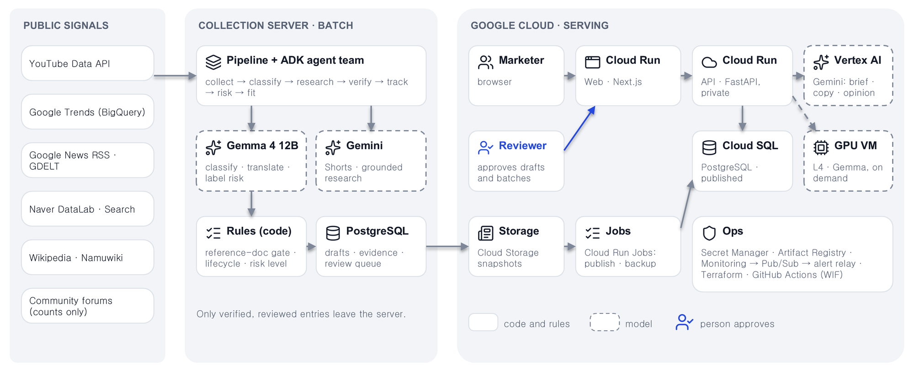
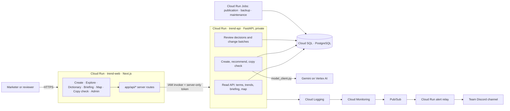
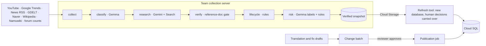
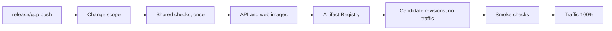

# Architecture

How Trend Interpreter is built and deployed, as of 2026-10-17. The diagram below is the same one as in the
[README](README.md#architecture). Korean design records live under [`docs/`](docs/README.md).

Solid boxes are code and rules, dashed boxes are models, and the blue icon marks where a person approves.

## At a glance

| Topic | Decision |
| --- | --- |
| Product | A per-market answer to "can my brand use this meme here, now?", plus copy for Korea, Japan and English-language markets (`apps/trend-web`, `apps/trend-api`) |
| Split | Heavy work (collection, classification, research, translation) runs in a batch on a separate team server. Google Cloud serves only verified, published data |
| Who decides | Rules decide listing, lifecycle, risk level and ranking. Models draft and describe. A person approves copy and dictionary changes |
| Request-time AI | Gemini on Vertex AI, through the runtime service account – no API key |
| Batch AI | Gemma 4 (local or Kaggle) classifies evidence, drafts translations and audits meanings; Gemini (Gemini API key, daily budget) reads Shorts and runs Search-grounded research |
| Data | PostgreSQL everywhere: Docker Compose locally, Cloud SQL for PostgreSQL in production |
| Region | Tokyo (`asia-northeast1`) |
| Deployment | Pushing `release/gcp` runs the checks, then deploys a candidate revision and moves traffic only after it passes |
| GPU | An L4 VM for live Gemma checks is defined in Terraform ([`infra/gcp/hybrid/gpu.tf`](infra/gcp/hybrid/gpu.tf)) but not deployed, to keep the cost down |

## Runtime

The browser never calls the API directly. Pages call same-origin Next.js server routes (`app/api/*`). A route checks
the session and role, then forwards the request with a token only the server knows. The API service requires an IAM
invoker, which only the web service account has. `DATA_MODE` and `TREND_API_URL` are server-side settings and never
reach the browser.

### Create: one product to approved copy

1. **Pick (rules).** Gemini turns a product photo or one line into a product brief. Rules score verified memes
   for each market by fit, tone, lifecycle and risk, and pick one, with the reasons and what was left out.
2. **Write and check.** One structured Gemini call per market writes 4 lines, a video script and a thumbnail plan in
   that market's language. Rules re-check every line (meme used, profanity, length, one language, no "like …"
   intros); a failing line is rewritten once or dropped. Gemini adds an opinion on whether the meme is used as meant.
3. **Approve (person).** Nothing can be copied until a reviewer approves. The approval is stored with the reviewer's
   account name, and every meme links to its dictionary entry and sources.

### Copy check

A marketer pastes their own copy. Rule matching (`pipeline/match.py`) finds the memes in it and labels each as fine,
use with care, fading, not used in that market, or avoid. Gemini only adds an opinion on meaning; it never sets the
label.

## Batch and publication

- **Refresh.** A new snapshot never overwrites the production database. The refresh tool loads it into a fresh
  database, carries over every human decision (reviews, approved meanings, risk calls, exclusions), the Gemini
  ledger and user tables, compares the result, and only then points the API at the new database. A refresh fails if
  any human decision would be lost.
- **Change batches.** Smaller changes – such as reviewed English translations – are grouped into a batch. A
  reviewer approves the batch on the admin screen, and the publication job applies exactly that batch, matched by
  its content hash.
- **Failure isolation.** Each pipeline step records its outcome in `pipeline_runs`, so one failed step does not stop
  the next.

## Model boundaries

| Setting | Local default | Meaning |
| --- | --- | --- |
| `MODEL_PROVIDER` | `mock` | A Gemini client is created only when this is `vertex` |
| `MODEL_REQUESTS_ENABLED` | `false` | No Gemini call is made unless this is `true` |
| `GCP_PROJECT_ID`, `GOOGLE_CLOUD_LOCATION` | empty | Vertex AI project and location |
| `GEMINI_DAILY_BUDGET` | `36` | Daily call cap, counted in the `gemini_calls` ledger table |
| `LOCAL_LLM_BASE_URL` | empty | Ollama or an OpenAI-compatible server for Gemma |

Request-time Gemini clients are created in one place, `src/trend_agents/model_client.py`. The pipeline goes through
`pipeline/gemini.py` for the budget, retries and a fallback model. Unless both switches are on, a call ends with
`ModelRequestsDisabled` and costs nothing, so the default development stack and CI never call a paid model. Local
model calls go through `interpreters/local_chat.py` only.

| Principle | Why |
| --- | --- |
| No PyTorch, CUDA or vLLM in the API image | Keep the web deployment small and separate from GPU runtimes |
| No model inference in CI | Avoid cost and non-reproducible results; tests cover code contracts |
| Models never set a status | Listing, lifecycle, risk and ranking stay explainable rule code |

## Environments

| Environment | Start | Models | Data |
| --- | --- | --- | --- |
| Default local | `docker compose up -d` | none | Sample data in the web app, Compose PostgreSQL |
| Local with real data | `DATA_MODE=api docker compose up -d` | none | Compose PostgreSQL |
| Local Gemma | Ollama or vLLM + `LOCAL_LLM_BASE_URL` | Gemma 4 | Compose PostgreSQL |
| Image check | `docker build` + `scripts/container-smoke.sh` | none | Throwaway PostgreSQL container |
| Production | `release/gcp` | Gemini on Vertex AI at request time | Cloud SQL for PostgreSQL |

## Code map

| Path | Responsibility |
| --- | --- |
| `apps/trend-web/app/` | Pages and server routes; `proxy.ts` limits `/me` and `/admin` to signed-in sessions |
| `apps/trend-web/lib/data.ts` | The only data access layer for pages; switches between sample data and the API |
| `apps/trend-web/lib/contract/` | JSON Schema and TypeScript types generated from `schemas.py` – not edited by hand |
| `apps/trend-api/src/trend_agents/api/app.py` | HTTP routes, account checks, review records |
| `apps/trend-api/src/trend_agents/schemas.py` | Contracts for collected data, interpretations and dictionary entries |
| `apps/trend-api/src/trend_agents/model_client.py` | Vertex AI Gemini client and the request switches |
| `apps/trend-api/src/trend_agents/pipeline/` | Pipeline steps, rule matching, the read-only tool loop |
| `apps/trend-api/src/trend_agents/collectors/` | Collectors for external sources |
| `apps/trend-api/src/trend_agents/interpreters/` | Gemini and local Gemma calls |
| `apps/trend-api/src/trend_agents/agents/team.py` | Optional ADK agent team that calls the same pipeline steps as tools |
| `apps/trend-api/src/trend_agents/storage/` | PostgreSQL adapter, connection pool, numbered migrations |
| `apps/alert-relay/` | Turns authenticated Pub/Sub alerts into allow-listed Discord messages |
| `models/` | Gemma runtimes and Kaggle notebooks, separate from the API |
| `infra/gcp/` | Terraform for the Google Cloud resources |
| `scripts/` | Release routing, smoke tests, deployment, refresh and rollback |

## What is stored

| Data | Stored? |
| --- | --- |
| Metadata and URLs of collected videos, search terms and news | Yes (no video files) |
| Dictionary entries, versioned meanings, evidence excerpts | Yes; old versions are closed, not deleted |
| Review decisions and the reviewer's account name | Yes |
| Copy approval records | Yes; the product line and copy text are deleted after 30 days |
| Text users ask about | Deleted after 7 days (interpretation cache) or 30 days (unanswered questions) |
| Gemini call ledger | Yes |
| Plain passwords, API keys, session secrets | No; accounts keep PBKDF2 hashes only |

Raw user text, generated output and credentials are kept out of operational logs. Schema changes go through numbered
SQL migrations recorded in `schema_migrations`.

## Deployment and operations

| Owner | Manages |
| --- | --- |
| Bootstrap script | Terraform state bucket, secret values, GitHub variables and environment |
| Terraform | APIs, Artifact Registry and its cleanup policy, service accounts and IAM, Workload Identity Federation, secret metadata, Cloud Run services and jobs, scheduler, monitoring, budget |
| Release workflow | Images, Cloud Run revisions and traffic |

- **Access.** GitHub Actions deploys through Workload Identity Federation; no service-account JSON key exists. Secret
  values stay out of Terraform state.
- **Scaling and limits.** Web and API scale from 0 to 2 instances. Recommend and create have a per-instance request
  limit, Gemini has a daily call cap, and Cloud Run has a monthly spend limit.
- **Scheduled jobs.** A backup job dumps the database daily at 03:00 KST to a private bucket kept for 14 days. A
  maintenance job at 04:00 KST deletes expired user text and checks that the published data is not stale.
- **Monitoring.** An uptime check watches the web app, and error alerts watch 5xx responses on web and API and failed
  scheduled jobs. Alerts go through Pub/Sub and the relay to the team's Discord channel.
- **Accounts.** Web accounts are PBKDF2 hashes in a secret. Reviewer accounts can approve; a read-only reviewer
  account sees every admin screen, and its decisions are refused by both the web routes and the API.

## Limits

- Collection depends on the team server; production shows the last published snapshot and its collection time.
- The Gemini daily budget is a ledger count, not a billing cap; real spend is checked in Cloud Billing.
- Accounts are a fixed list, not per-user sign-up (no Firebase Auth).
- Live Gemma checks are coded but answer "GPU off" in production, because the GPU VM is not deployed.
