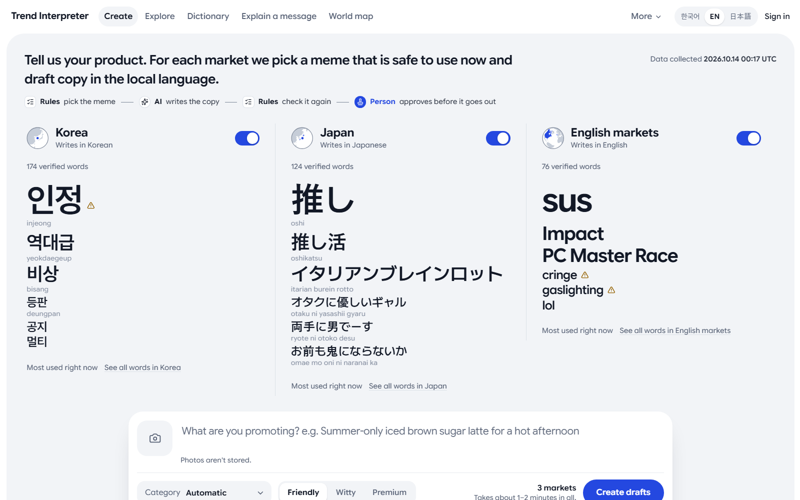
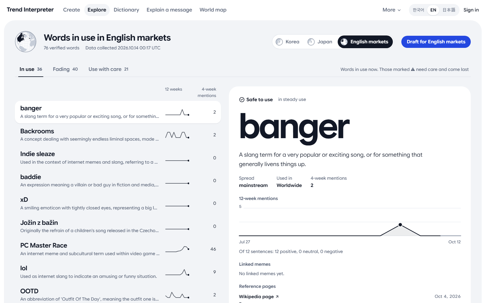
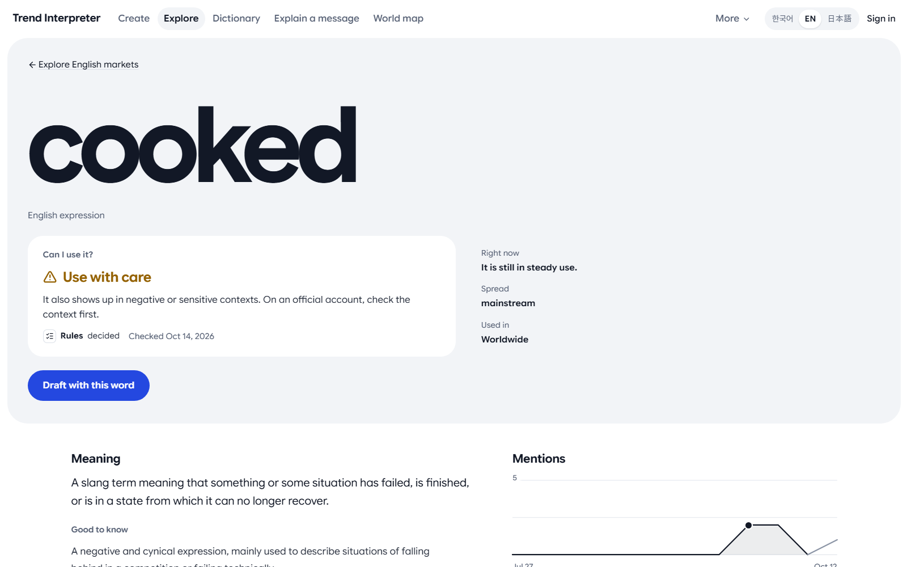
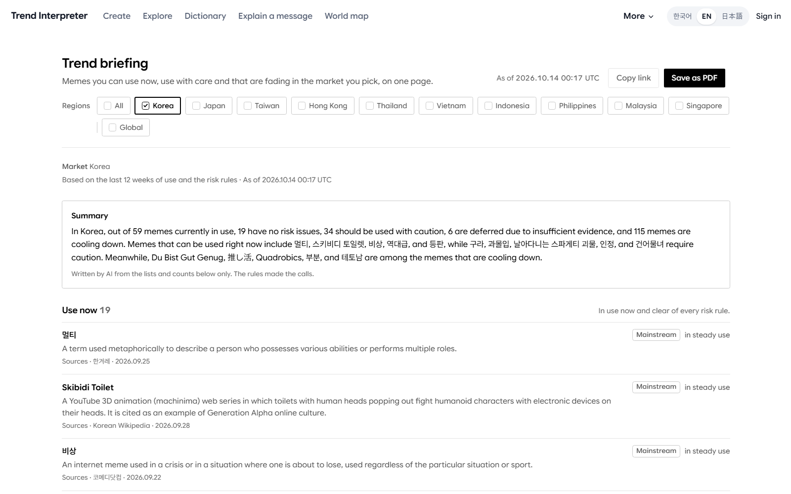
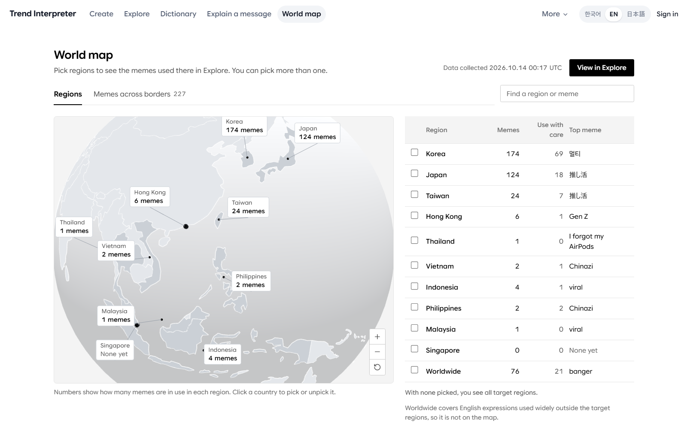

# AI Builder Cup 2026

English | [한국어](README.kr.md) | [First-time setup guide in Korean](docs/개발환경/처음-설치.md)

**Trend Interpreter** turns one product into local copy for Korea, Japan and English-language markets, using
memes that are in use there now and safe for a brand – with a source behind every claim and a person approving
before anything goes out.

Google Cloud AI Builder Cup 2026 (JAPAC) · Theme: **Media, Content & Digital Experiences** · Team **COPYBARA**

| | |
| --- | --- |
| Live prototype | [trend-production-web-7jftqxfz3q-an.a.run.app](https://trend-production-web-7jftqxfz3q-an.a.run.app/?lang=en) (Cloud Run; `?lang=en`, `ko` or `ja` sets the language) |
| Demo video (under 3 minutes) | Added at submission |
| Evaluation | [EVALUATION.md](EVALUATION.md) · per-round totals in [`evals/`](evals/recommend-rounds.csv) |
| Architecture | [Diagram](#architecture) · [architecture document](docs/운영/시스템-아키텍처.md) (Korean) |



The repository holds the Next.js web app, the FastAPI API with its collection and dictionary pipeline, the
Discord alert relay, and the GCP infrastructure. Other candidate projects under `prototype/` are kept for
reference only.

## What it does

Brand marketers and creators ask one question about a meme: can we use it now, here, without trouble?
Trend Interpreter answers it per market (ten Asia-Pacific markets plus a global group) from collected public data.

**Why it matters.** Brands already speak in memes: in a Morning Consult survey (September–October 2024, 1,002 Gen
Z respondents) 71% of Gen Z social media users had seen brands use internet slang or trends in the past month,
and their reaction was split, 42% liking it and 32% not
([Morning Consult, 2024-12-09](https://intel.morningconsult.com/mc-content/analysis/brands-social-media-trends)).
Getting the meaning or the origin wrong is public: in October 2023 the Korean e-commerce platform Wemakeprice sent a
sale message in the speech style of a convicted fraudster that had become a meme, and was criticised for making
light of the crime ([eToday, 2023-10-30](https://www.etoday.co.kr/news/view/2297322)).
In May 2026 Starbucks Korea ran a "Tank Day" tumbler promotion on the anniversary of the 1980 Gwangju Democratic Uprising, whose crackdown used tanks; it was pulled within
hours, the CEO was fired and shares of its parent Emart fell 6% the next day
([The Korea Herald, 2026-05-19](https://www.koreaherald.com/article/10741050)). Slang itself carries a cost: a 2025
Journal of Marketing Research study found shoppers tend to read brand slang as inauthentic, younger ones about as
negatively as older ones ([BakeryandSnacks, 2026-08-21](https://www.bakeryandsnacks.com/Article/2026/08/21/why-internet-slang-can-damage-food-and-drink-brands/)).
Across markets the same gesture or phrase can read differently; Swatch withdrew a campaign image in China in 2025 after a gesture in it was
seen as derogatory ([PBS NewsHour](https://www.pbs.org/newshour/amp/world/swatch-apologizes-for-ad-showing-gesture-seen-as-derogatory-and-racist)).
A marketer needs the meaning, where it lives, whether it is fading and where it came from, before posting.

| Feature | What the user gets |
| --- | --- |
| Trend dashboard | Memes in use now, fading and needing care, with lifecycle stage, risk, 12-week mentions and an at-a-glance summary of what is safe to use |
| Meme dictionary | Versioned meanings with cited sources, regions, per-country variants and history |
| Trend briefing | One-page market report to save as PDF or share, with a summary written only from the listed facts |
| Campaign kit | Meme picks for a product photo or copy, then SNS copy, a short-form script and a thumbnail plan, checked against the dictionary |
| Copy check | Flags memes in your own copy that are risky, fading or foreign to the market, and gives an AI opinion on whether each is used in the right sense |
| Message explain and dictionary chat | Rewrites a pasted message in plain words; a read-only tool-calling chat answers only from the dictionary |
| World map and recent changes | Where a meme is used and what changed lately |
| Reviewer console | Human approval queue for new meanings, corrections and risk decisions |

### Screens

| Explore: memes in use, fading or needing care, here for English markets | Dictionary entry: can I use it, meaning and sources (“cooked”) |
| --- | --- |
|  |  |
| **Trend briefing: a one-page market report** | **World map: memes per market and across borders** |
|  |  |

Screens of the deployed service in English, on data collected on 9 October 2026. Memes stay in their own script; explanations follow the interface language.

## How AI is used

Rules decide, models write. Listing, lifecycle, verification status, risk level, list filtering and
recommendation ranking are deterministic code; a model never sets a status.

- **Gemini on Vertex AI** (runtime service account, no API key, monthly spend cap): researches new terms with
  grounding, reads trending short videos, turns a product photo or copy into a product brief, writes campaign
  copy, summarises the briefing and judges whether copy uses a meme in the right sense.
- **Gemma 4** (local, Kaggle or an on-demand GPU VM): drafts headword readings and meaning translations for newly
  listed terms, classifies evidence sentences for risk and audits dictionary meanings against their sources. A QLoRA fine-tune of the auditor
  learned the verdict format but did not show better judgement, so the base model is used
  ([EVALUATION.md](EVALUATION.md)).
- **Agent Development Kit (ADK)**: an optional four-agent team (collector → investigator → lexicographer → publisher)
  calls the same deterministic pipeline steps as tools and writes a run report; the agents never set a status
  ([`agents/team.py`](apps/trend-api/src/trend_agents/agents/team.py)).
- The collection server calls Gemini through the Gemini API (Google AI Studio key) under a daily call budget.
- Every model output is checked by rules before it is shown: a meaning needs a matching reference document,
  generated copy is re-checked for the chosen meme, profanity and length, and empty or note-like meanings are
  held back.

Where this shows in the deployed app:

- Each dictionary entry says that rules decided its risk level from real sentences Gemma labelled, and the Explore
  detail sums them up (for example "Of 12 sentences: 12 positive"), with a short "how this entry was made" note.
  Community posts are counted, never quoted.
- [`/about`](apps/trend-web/app/about/page.tsx) explains in plain words what Gemini, Gemma, the rules and people
  each do. Model names stay off the other user-facing screens.
- The reviewer status page shows, per pipeline step, how many published results each model produced and the
  model calls and time spent in the last 24 hours.
- Reviewer tools can send a term's latest news headlines, or up to five chosen terms, to Gemma on an on-demand GPU
  VM and show the result next to the published verdict, graded by the same rules and never saved. The GPU VM is not
  running in the deployment (it costs money and is started by the team only for demos), so these two buttons answer
  at once that the GPU is off. Gemma's batch work is shown in the model records on the reviewer status page.

Judges can sign in with the read-only reviewer account given in the submission form: every admin screen opens, and
approve, reject and risk decisions are refused.

What we measured, with numbers and limits, and what is still open: [EVALUATION.md](EVALUATION.md).

## Architecture


Solid boxes are code and rules, dashed boxes are models, and the blue icon marks where a person approves.

## Google Cloud services

| Service | Use |
| --- | --- |
| Cloud Run | Web app, private API and alert relay; new revisions are tested before traffic moves |
| Cloud SQL for PostgreSQL | Published dictionary, evidence and dashboard data |
| Vertex AI (Gemini) | Request-time research, generation and summaries |
| Compute Engine GPU (L4) | Gemma gateway for the reviewer tools above, defined in Terraform and started only when needed |
| Cloud Storage | Fixed data snapshots handed from the collection server |
| Cloud Logging, Monitoring, Pub/Sub | Alerts relayed to the team's Discord channel |
| Secret Manager | Runtime secrets |

Collection runs on a separate team server; only verified snapshots are published to Cloud SQL.
Details are in the [architecture document](docs/운영/시스템-아키텍처.md) (Korean).

## Local development

Install Git and Docker with Compose v2. No host Node, Python, uv, model key or GPU is required
for the default workflow. Docker Desktop must be running.

```bash
git clone --branch develop https://github.com/Sihyeon-Ji/2026-google-ai-builder-cup.git
cd 2026-google-ai-builder-cup
docker compose up -d
```

Open **http://localhost:3000**. Compose builds the development images on the first run, starts
PostgreSQL, the API and then the Next.js dev server. The API is available at http://localhost:8000/docs.
Use `docker compose ps` to check readiness; initial image downloads may take several minutes.

- The web starts in **sample mode** with built-in example data. `DATA_MODE=api docker compose up -d`
  switches it to the local API, which reads the PostgreSQL database in the `postgres_data` volume.
- All relational data lives in PostgreSQL (`DATABASE_URL`). The development database is loopback-only
  with fixed local credentials and no published port.
- Changes in `apps/trend-web/` (app, components, lib, public) reload through Next.js Fast Refresh.
- Changes in `apps/trend-api/src/` restart the API through Uvicorn reload.
- Dependencies stay inside the images, separate from host `.venv` and `node_modules`.
- Node is **24.21.0** with pnpm through Corepack; Python is **3.12** with uv.
- The API runs with `MODEL_PROVIDER=mock` and `MODEL_REQUESTS_ENABLED=false`. It never calls a paid
  model, and the development services do not load the host `.env` or cloud credentials.

Changing dependency manifests, lockfiles, Dockerfiles or Compose settings requires a rebuild:

```bash
docker compose up -d --build
```

The development servers are exposed only on host loopback; this is not a production deployment.

## Everyday commands

Run these from the repository root. Compose is the single entry point; there is no Makefile or
extra task runner to install. See the [Korean command reference](docs/개발환경/개발-명령어.md).

| Command | Purpose |
| --- | --- |
| `docker compose up -d` | Start the API and the web dev server |
| `docker compose ps` | Check service status |
| `docker compose logs -f` | Follow logs; Ctrl-C stops following, not the services |
| `docker compose down` | Stop and remove the development containers; the database volume stays |
| `docker compose up -d --build` | Rebuild after dependency or configuration changes |
| `docker compose run --rm --build check` | API tests, release and relay tests, web lint and production build |
| `docker compose run --rm security-check` | Scan the three service lockfiles with OSV-Scanner |
| `docker compose run --rm --build e2e` | Run Chromium browser tests against the production API and web images |
| `docker compose run --rm infra-check` | Format-check, initialize and validate Terraform locally |
| `docker compose run --rm --build uv add httpx` | Edit `apps/trend-api` dependencies and lockfile |
| `docker compose run --rm --build pnpm add zod` | Edit `apps/trend-web` dependencies and lockfile |

`check`, `security-check`, `e2e`, `infra-check`, `uv` and `pnpm` are opt-in services; plain `up -d`
starts only `db`, `api` and `web`. `check` starts `db` for the API tests, which isolate themselves in
temporary schemas. E2E starts its dependent development services if necessary. Its first
build also installs Chromium inside the test image.

Passing checks confirm the code contract and the build, **not** AI quality. Real Gemini access,
collector keys and GPU inference are never exercised by the default stack or by CI. Measured AI quality is in [EVALUATION.md](EVALUATION.md).

## Dependency changes

Use the Compose `uv` and `pnpm` tools so the manifest and lockfile change together on the host:

```bash
docker compose run --rm --build uv add httpx
docker compose run --rm --build pnpm add zod
```

Package names above are examples. Rebuild with `docker compose up -d --build`, run `check` and
`e2e`, then commit `pyproject.toml` / `uv.lock` or `package.json` / `pnpm-lock.yaml` in the same commit.
Production and development builds reject out-of-date lockfiles.

## Model access

| Setting | Local default | Production intent |
| --- | --- | --- |
| `MODEL_PROVIDER` | `mock` | `vertex` |
| `MODEL_REQUESTS_ENABLED` | `false` | `true` only while the service is meant to spend |
| `GCP_PROJECT_ID`, `GOOGLE_CLOUD_LOCATION` | empty | Vertex AI project and location |
| `GEMINI_DAILY_BUDGET` | `36` | daily call cap recorded in the database |

Gemini clients are created only in `apps/trend-api/src/trend_agents/model_client.py`, through Vertex AI
with the Cloud Run runtime service account. There is no Gemini API key anywhere in the codebase.
Local Gemma runs through Ollama or an OpenAI-compatible server (`LOCAL_LLM_BASE_URL`); see
[Gemma/vLLM](models/vllm/README.md). Collector keys (YouTube, Naver) belong only in
`apps/trend-api/.env`; see `apps/trend-api/.env.example`.

## Repository layout

```text
compose.yaml                 Development services and opt-in validation tools
Dockerfile.dev               Development toolchain and browser-test image
apps/trend-web/              Next.js web app, browser tests, production Dockerfile
apps/trend-api/              FastAPI API, collection and dictionary pipeline on PostgreSQL, production Dockerfile
apps/alert-relay/            Private Cloud Run relay from Pub/Sub alerts to Discord
models/vllm/                 Separate GPU-host Gemma runtime
infra/gcp/                   Terraform infrastructure
.github/workflows/           CI and release/gcp deployment
scripts/                     Release, smoke-test and cloud operation implementation
tests/                       Release routing and recovery tests
prototype/                   Earlier candidate projects, not built or scanned
docs/                        Korean documentation: setup, operations, Trend design records, plans
```

## Team and documentation

- [Documentation index in Korean](docs/README.md)
- [Trend direction, pipeline and research records in Korean](docs/트렌드/방향.md)
- [Current plans in Korean](docs/plans/README.md)
- [First-time setup in Korean](docs/개발환경/처음-설치.md)
- [Architecture](docs/운영/시스템-아키텍처.md)
- [Operations](docs/운영/GCP-운영.md)
- [Team workflow](docs/개발환경/팀-작업-방식.md)
- [Repository](https://github.com/Sihyeon-Ji/2026-google-ai-builder-cup)
- [Project board](https://github.com/users/Sihyeon-Ji/projects/1)

## License

[Apache License 2.0](LICENSE). Third-party libraries keep their own licenses.
