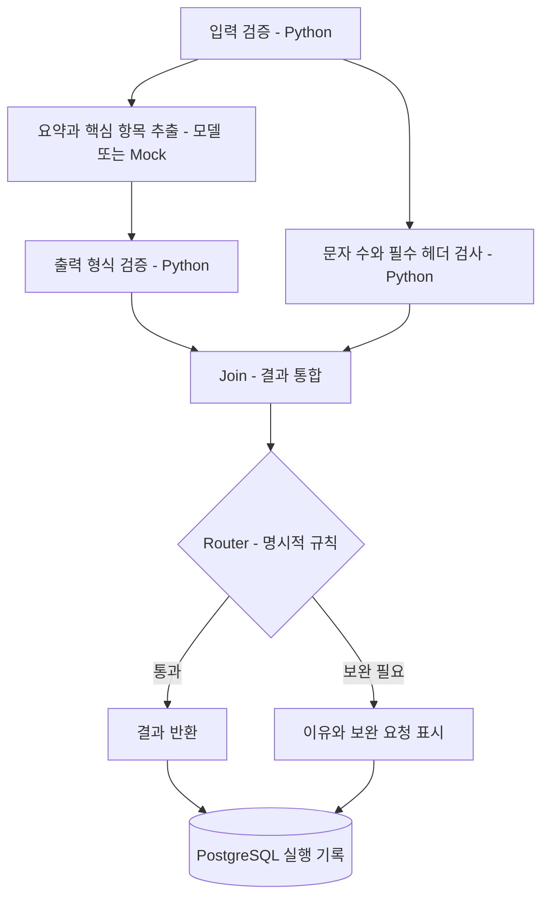
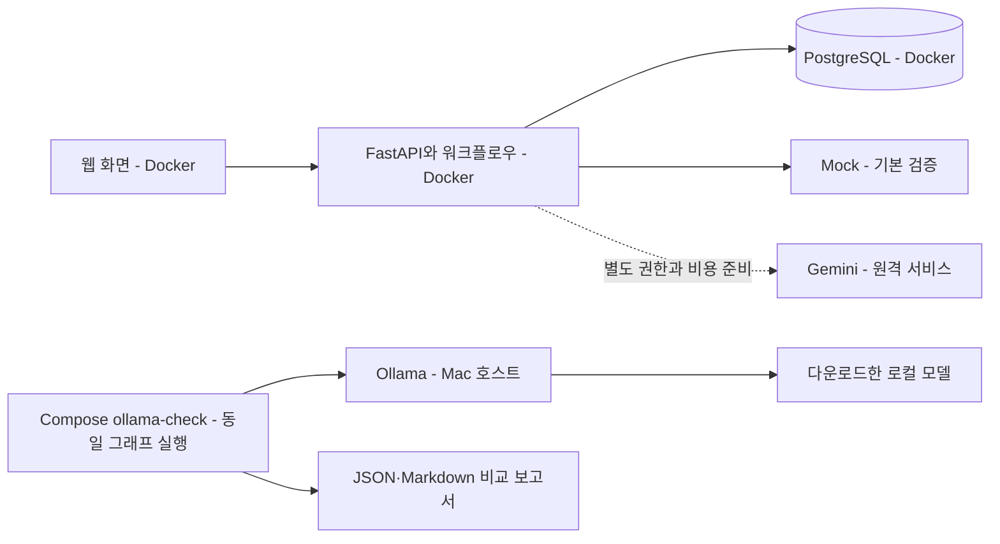

# 로컬 LLM, 에이전트와 그래프 워크플로우 이해하기

> 2026-09-28 기준 이 실습에 쓰인 루트 앱 코드(`apps/api`, `apps/web`, 실습 Compose 서비스)는 저장소에서 제거했습니다. 개념·조사 내용은 유효하며 당시 명령과 코드는 Git 이력에서 확인합니다. 현재 메인 앱은 `apps/trend-api`·`apps/trend-web`입니다.

[실습 계획과 준비물](AI-실습-기록.md) | [한국어 README](../../README.kr.md) | [현재 아키텍처](../운영/시스템-아키텍처.md)

Trend Interpreter의 최신 Gemma 배치·Cloud Run GPU 비용 결정은 [Gemma 4 로컬 편집 엔진 결정](Gemma-로컬-편집-엔진-결정.md)을 참고합니다.

구현 후의 당시 준비 상태와 다음 작업은 [1~5단계 종합 보고서](AI-개발-종합-보고서.md)에 정리했습니다.
현재 Cloud Run·결제·알림은 활성화되어 있으므로 운영 상태는 [GCP 운영 문서](../운영/GCP-운영.md)를 확인합니다.

조사 기준일은 **2026-09-19**입니다. 대화에서 제공된 영상 요약과 공식 문서를 바탕으로 정리했습니다.
영상 원본을 직접 확인한 기록은 아닙니다. **2026-09-21에 5단계 실습까지 구현·검증**했으며,
현재 상태는 아래 표와 [실습 기록](AI-실습-기록.md)에서 확인할 수 있습니다.

## 먼저 구분할 개념

| 개념 | 역할 | 예시 |
| --- | --- | --- |
| LLM | 입력을 받아 텍스트·구조화된 결과 생성 | 문서에서 요약과 핵심 항목 생성 |
| 모델 런타임 | 모델을 메모리에 올리고 추론 요청 처리 | Ollama, 별도 GPU 서버의 vLLM |
| 도구 | 에이전트가 호출할 수 있는 함수·API | 문서 조회, 계산, DB 검색 |
| 에이전트 | 모델과 도구를 조합해 작업 수행 | 필요한 문서를 선택하고 읽어서 답변 |
| 그래프 워크플로우 | 작업의 순서·병렬 실행·조건부 이동 제어 | 정보 추출과 규칙 검사를 실행하고 통합 |
| DB | 데이터와 실행 기록 보관 | 실행 상태, 단계별 소요 시간, 문서 메타데이터 |

개발용 코딩 에이전트는 코드를 작성·검사하는 개발 도구입니다.
제품 안의 에이전트는 사용자의 요청을 처리하는 애플리케이션 기능입니다.
여러 코딩 에이전트를 사용하는 것과 제품을 다중 에이전트 시스템으로 만드는 것은 서로 다른 결정입니다.

**로컬 에이전트와 로컬 모델도 다릅니다.** Python 에이전트가 Mac이나 Docker에서 실행되면서
추론만 원격 Gemini에 요청할 수 있습니다. 모델을 Mac에 내려받아 추론하는 경우가 로컬 모델 실행입니다.
모델 호출은 이미 학습된 모델을 사용하는 것이며, 모델을 직접 학습시키는 작업은 아닙니다.

## 그래프 엔지니어링에 그래프 DB가 필요한가?

**필요하지 않습니다.** 이 문서에서 그래프 엔지니어링은 작업을 노드와 연결로 나누는 실행 흐름 설계입니다.

| 구분 | 실행 그래프 | 그래프 DB |
| --- | --- | --- |
| 노드 | 함수, 모델 호출, 에이전트 | 사람, 회사, 문서, 사건 |
| 에지 | 다음 작업, 실행 조건 | 소속, 거래, 참조 등 데이터 관계 |
| 해결하는 문제 | 어떤 작업을 언제 실행할 것인가 | 어떤 데이터가 어떻게 연결되어 있는가 |
| 예시 | 검색 → 요약 → 검증 | 사람이 회사에 소속되고 회사끼리 거래 |

작업 그래프는 DB 없이도 실행할 수 있고, 실행 기록을 PostgreSQL에 저장할 수도 있습니다.
그래프 DB는 여러 단계의 관계 탐색이 핵심 기능이 될 때 검토합니다.
Neo4j는 데이터를 노드·관계·속성으로 표현하는 그래프 DB의 예입니다.
[Neo4j의 그래프 DB 개념](https://neo4j.com/docs/getting-started/appendix/graphdb-concepts/)

## 작은 워크플로우로 보는 Fan-out, Join, Router

아래는 구현한 학습용 흐름의 개념도입니다. 최종 대회 주제를 뜻하지 않습니다.

**Fan-out**은 독립적인 작업을 병렬로 실행하는 것입니다. 원문에 대한 정보 추출과 문자 수 검사는
서로의 결과를 기다릴 필요가 없습니다. 반면 생성된 요약의 품질 검사는 요약이 나온 뒤에 해야 합니다.

**Join**은 각 단계의 결과를 정해진 데이터 구조로 합칩니다. 결과 누락, 중복 필드, 한쪽 작업 실패를
어떻게 처리할지도 정해야 합니다. 여러 결과를 문자열로 붙이는 것만으로 검증이 끝나지는 않습니다.

**Router**는 다음 경로를 선택합니다. 길이 제한·필수 항목·오류 코드처럼 명확한 기준은 Python 조건으로
처리하고, 자연어 의도를 분류해야 할 때만 LLM 라우터를 검토합니다.
LLM 라우터도 가능한 경로를 제한하고 알 수 없는 결과를 처리해야 합니다.

처음에는 같은 모델을 다른 역할로 여러 번 호출해도 됩니다. 에이전트 역할마다 별도의 모델이나
컨테이너가 반드시 필요한 것은 아닙니다. 고정 워크플로우와 동적으로 도구를 선택하는 에이전트의
차이 및 병렬화 패턴은 [LangGraph 공식 예제](https://docs.langchain.com/oss/python/langgraph/workflows-agents)에서도 확인할 수 있습니다.

## 신뢰성과 비용에 대한 주의점

- 그래프 구조는 흐름을 통제하고 실패를 추적하기 쉽게 만듭니다. 환각을 자동으로 제거하지는 않습니다.
- JSON 형식이 맞는 것과 내용이 사실인 것은 다릅니다. 인용 문서가 존재하는 것과 주장을 뒷받침하는 것도 다릅니다.
- Python 함수에는 모델 토큰 비용이 없지만 실행 자원·외부 API 비용까지 항상 0인 것은 아닙니다.
- 모델 호출을 병렬로 하면 대기 시간을 줄일 수 있지만 호출별 토큰 비용은 합산됩니다.
- 노드 수가 늘면 시간 제한, 동시 실행 제한, 재시도 횟수와 부분 실패 정책도 필요합니다.
- 실행 이력을 저장하는 것만으로 중단한 워크플로우의 자동 재개가 구현되지는 않습니다.

초기 실습은 전체 시간 제한, 제한된 재시도, 노드별 입력·출력 형식, 실패 코드가 드러나는 구조를 목표로 합니다.
검증 기준은 모델에게 "틀리지 말라"고 지시하는 것과 별도로 코드와 테스트로 작성합니다.

## 어떤 DB를 준비할까?

| 선택지 | 유용한 시점 | 현재 제안 |
| --- | --- | --- |
| PostgreSQL | 일반 데이터와 실행 기록을 함께 저장 | 첫 DB로 준비 |
| PostgreSQL JSONB | 구조가 일부 다른 메타데이터 보관 | 필요한 필드에 사용 |
| pgvector | 임베딩 기반 문서 유사도 검색 | 검색 실습이 생기면 추가 |
| 그래프 DB | 사람·조직·사건 등의 관계와 다단계 탐색이 핵심 | 해당 요구가 확인되면 검토 |

PostgreSQL은 관계형 데이터와 JSON 데이터를 지원합니다. pgvector는 PostgreSQL에서 벡터 유사도 검색을
제공하는 확장입니다. pgvector를 설치한다고 문서 임베딩까지 생성되는 것은 아니므로,
검색에 사용할 임베딩 모델과 차원·버전 관리도 별도로 필요합니다.
[PostgreSQL JSON 지원](https://www.postgresql.org/docs/current/datatype-json.html),
[pgvector 공식 저장소](https://github.com/pgvector/pgvector)

처음에는 실행 ID, 노드 ID, 상태, 소요 시간, 모델·프롬프트 버전, 토큰 사용량, 오류 코드를 저장하는 것으로 충분합니다.
원문·생성 결과를 저장해야 한다면 운영 로그와 구분된 데이터로 취급하고 보관·삭제 정책을 정합니다.
첫 실습에서는 합성 입력을 사용하고 운영 로그에는 원문·생성 결과·인증정보를 기록하지 않습니다.

## Python, ADK, LangGraph 선택

| 방식 | 장점 | 선택 기준 |
| --- | --- | --- |
| 일반 Python 함수와 비동기 실행 | 흐름과 실패 정책을 직접 이해하기 쉬움 | 작은 고정 그래프 실습 |
| Google ADK | Google 모델·에이전트 생태계와 연결 | 대회용 에이전트 요구가 구체화될 때 우선 검토 |
| LangGraph | 상태를 가진 그래프 실행과 지속성 기능 | 중단·재개와 복잡한 상태 전이가 중요해질 때 비교 |

ADK 2.0 공식 문서는 그래프 기반·동적·협업 워크플로우를 구분하며 모델 노드와 결정론적 노드를
함께 구성할 수 있다고 설명합니다. LangGraph는 상태를 가진 워크플로우의 실행과 지속성 등을 지원합니다.
[ADK 워크플로우](https://adk.dev/workflows/), [LangGraph 개요](https://docs.langchain.com/oss/python/langgraph/overview)

현 단계에서는 두 프레임워크를 동시에 도입하지 않습니다. 먼저 작은 흐름과 실패 정책을 정하고,
그 요구를 충족하는 가장 단순한 구현을 선택하는 것이 제안입니다. 프레임워크·정확한 버전은 아직 확정하지 않았습니다.

## Mac에서 실제 모델을 실행한다면

현재 저장소의 vLLM 안내는 별도 Linux·NVIDIA GPU 서버를 전제로 합니다.
Mac 실습에서는 Ollama를 호스트에서 실행하고 별도 Compose 비교 명령에서 호출합니다.
Ollama는 Apple Metal GPU 가속을 지원하며, 공식 FAQ는 macOS Docker Desktop 안에서는
Ollama GPU 가속을 사용할 수 없다고 설명합니다.
[Ollama GPU 지원](https://docs.ollama.com/gpu), [Ollama Docker FAQ](https://docs.ollama.com/faq)

그림의 Ollama 경로는 `ollama-check`에서 검증했으며 기본 UI/API는 여전히 Mock입니다.
실제 모델 비교는 PostgreSQL 이력 대신 평가 파일에 결과를 남깁니다.
모델 크기, 양자화, 컨텍스트 길이와 동시 실행 수에 따라 메모리 사용량이 달라집니다.
로컬 실습 모델은 Google AI Builder Cup 범위에 맞춰 Gemma 4 계열만 사용하며,
현재 Mac 기준 모델은 Ollama `gemma4:e4b`이며 Provider가 다른 로컬 모델 이름을 거부합니다.
로컬 모델의 토큰 API 요금은 없지만 다운로드·저장 공간·실행 자원은 필요합니다.
Ollama를 사용하더라도 클라우드 모델을 선택하면 로컬 추론과 다르므로 실행 모드를 명시해야 합니다.

컨테이너에서 호스트 모델에 연결하는 주소, 접근 범위와 모델 API의 호환성은 실제 연결 단계에서 검증합니다.
API가 응답하는 것, 모델이 추론하는 것, 답변 품질이 충분한 것은 각각 별도의 확인 항목입니다.

## 현재 저장소에 있는 것과 없는 것

| 구분 | 2026-09-21 확인 상태 |
| --- | --- |
| Docker Compose 웹·API, 소스 자동 반영, 검사·E2E | 기존 기반에 있음 |
| Mock·Gemini·vLLM Provider와 결과 검증 | 코드가 있음. 기본 Compose는 Mock |
| PostgreSQL 서비스와 DB 연결 | 1단계 완료. 합성 기록 저장·조회·재시작 후 유지 확인 |
| Fan-out·Join·Router 실습 | 2단계 완료. 합성 문서 3종의 입력 검사·병렬 실행·분기 검증 |
| 노드별 실행 이력 조회 | 3단계 완료. PostgreSQL 저장·목록/상세 API·웹 화면·재시작 후 유지 검증 |
| 실패·취소·재시도 실습 | 4단계 완료. Mock 시나리오 선택·오류 재현·복구 이력 검증 |
| Ollama 연결 및 실제 로컬 추론 | Mac Ollama 0.34.2·Gemma 4 E4B로 합성 문서 비교. Gemma 4 이외 모델은 코드에서 거부 |
| 그래프 DB | 미도입. 실행 그래프 실습에 필수 아님 |

주제 후보인 `prototype/disease`는 이번 실습 범위와 분리합니다.
GCP 리소스 생성·과금 활성화·`release/gcp` push 보류는 이 실습 당시의 범위였으며 현재는 해제됐습니다.
다음 작업은 [5단계 실습 계획과 준비물](AI-실습-기록.md)에 기록했습니다.
