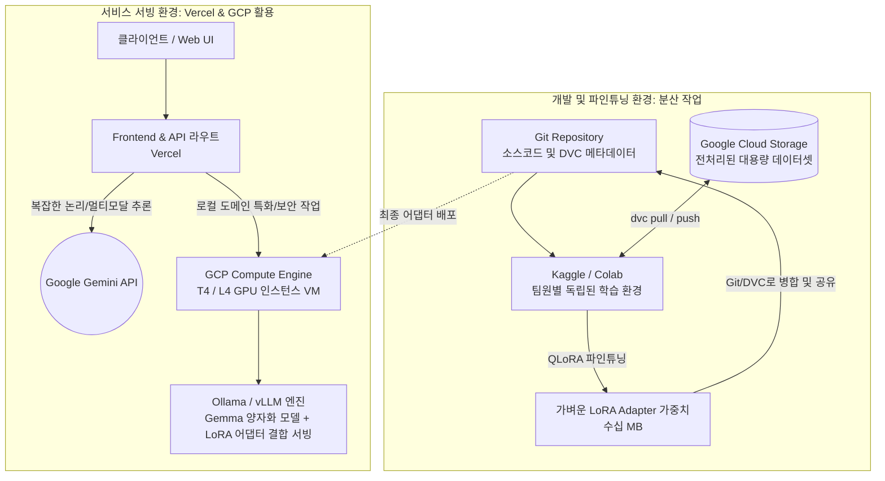

# Google AI Builder Cup: Gemma + Gemini 하이브리드 아키텍처 제안서

본 문서는 사내 보안망 제약을 극복하고 제한된 리소스 환경에서 팀원 간 분산 작업(데이터/모델 관리)과 효율적인 모델 서빙을 구현하기 위한 아키텍처 가이드입니다.

**💡 팀 핵심 개발 포커스**

우리 팀의 핵심 목표는 딥러닝 모델을 바닥부터 학습시키는 것이 아닙니다. **대회 목적에 맞는 질 좋은 데이터셋을 모아서, Kaggle 환경에서 QLoRA 파인튜닝 코드를 돌려 우리만의 특화된 Gemma 어댑터(수십 MB)를 뽑아내는 것**에 모든 개발 역량을 집중해야 합니다.

## 1. 대용량 데이터셋 관리와 DVC (Data Version Control)

파인튜닝에 사용되는 전처리된 대용량 데이터셋(JSONL 등)은 용량이 커서 일반적인 Git으로 공유할 수 없습니다. 이를 해결하기 위해 **GCS(Google Cloud Storage)와 DVC를 연동**합니다.

- **전처리된 데이터셋:** 크롤링된 날것의 데이터에서 노이즈를 제거하고, LLM이 학습할 수 있는 `{"instruction": "...", "output": "..."}` 형태의 포맷으로 정제한 파일(수십 GB)을 의미합니다.
- **DVC (Data Version Control):** 코드를 관리하는 Git처럼 **'대용량 데이터와 모델 가중치'의 버전을 관리해 주는 도구**입니다.
- **Git + DVC + GCS 연동 흐름**

        1. 무거운 실제 데이터 파일(`.jsonl`, `.bin`)은 구글 클라우드 스토리지(GCS)에 업로드됩니다.
        2. DVC는 이 파일들의 메타데이터와 해시값만을 담은 가벼운 `.dvc` 파일을 생성합니다.
        3. 팀원들은 Git을 통해 가벼운 `.dvc` 파일과 소스코드를 `git pull`로 공유받습니다.
        4. 이후 `dvc pull` 명령어를 실행하면, DVC가 알아서 GCS에 접속해 내 코드 버전에 맞는 실제 대용량 데이터를 다운로드하여 완벽한 동기화를 이룹니다.

## 2. Kaggle 내 vLLM 활용 및 양자화(Quantization) 지원 여부

Kaggle 환경에서 vLLM 엔진을 활용하여 모델을 서빙하거나 추론 속도를 높일 수 있는지 조사한 결과입니다.

- Kaggle에서 vLLM 사용 가능 여부: **가능합니다.** 단, Kaggle Notebook에 기본 설치된 패키지와 의존성 충돌이 발생할 수 있어, 노트북 시작 시 `!pip install -U vllm torch`를 통해 버전을 맞춰주는 작업이 필요합니다. 또한 Kaggle에서 제공하는 T4 GPU(Turing 아키텍처)의 경우 FlashAttention을 지원하지 않아 vLLM이 자동으로 XFormers 백엔드로 전환(Fallback)되어 실행됩니다.
- **양자화(Quantization) 지원:** vLLM은 **AWQ, GPTQ, GGUF** 등 최신 양자화 포맷을 완벽하게 지원합니다. 모델 로드 시 `vllm.LLM(model="...", quantization="awq")`와 같이 파라미터만 넘겨주면, VRAM 사용량을 대폭 줄인 상태에서 매우 빠른 속도로 추론이 가능합니다.

## 3. PEFT (LoRA / QLoRA) 파인튜닝과 품질 영향

- **개념:** PEFT(Parameter-Efficient Fine-Tuning)는 수십억 개의 가중치를 모두 재학습(Full Fine-tuning)하는 대신, 기존 모델의 뇌(가중치)는 얼려두고(Freeze) **외부에 아주 얇은 추가 학습 레이어(어댑터)만 붙여서 학습**하는 기법입니다. 여기에 모델 양자화까지 결합해 VRAM을 극단적으로 줄인 것이 QLoRA입니다.
- **품질 영향:** 기존 모델의 똑똑한 지능을 훼손하지 않으면서도 특정 말투를 흉내 내거나 포맷에 맞춰 대답하게 하는 데에는 **풀 파인튜닝 대비 거의 동일한 수준의 성능**을 발휘합니다.
- **분산 작업 적용의 이점:** QLoRA로 학습한 결과물(어댑터)은 용량이 수십 MB 단위에 불과합니다. 따라서 팀원들이 각자 Kaggle이나 로컬에서 실험한 모델 가중치를 메신저나 Git/DVC로 손쉽게 공유하며 애자일(Agile)하게 협업할 수 있습니다.

## 4. 최종 제안 아키텍처 흐름도

결론적으로, [개발/학습은 분산 환경]에서, [서비스 서빙은 클라우드 환경]에서 처리하는 구조를 제안합니다.

