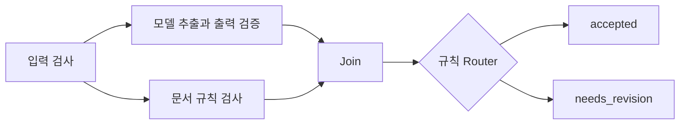

# AI 개발 기반 구축 종합 보고서

작성일 **2026-09-21** · 구현 기준 **`2af238f`** · 범위 **로컬 개발환경과 1~5단계 학습 실습**

[한국어 README](../README.kr.md) · [단계별 실습 기록](ai-lab-plan.md) · [실행 명령어](commands.md) · [개념 설명](ai-development-guide.md)

## 0. 개요

이번 1~5단계 실습으로 **“문서를 받아 AI로 처리하고, 문제가 생기면 어느 단계에서 실패했는지 확인할 수 있는 개발용 실험실”**을 만들었습니다.

| 쉽게 말하면 | 지금 해 볼 수 있는 일 |
| --- | --- |
| 기록을 남기는 창고 | DB에 저장한 실행 기록을 Docker 재시작 후에도 읽기 |
| 작업 순서를 정한 처리 과정 | 문서 요약과 필수 항목 검사를 병렬로 실행하고 결과 합치기 |
| 실행 과정을 보는 기록장 | 실패한 단계·소요 시간·모델·토큰 확인 |
| 일부러 고장 내 보는 연습 | AI 지연·잘못된 JSON·일부 작업 실패·재시도 시험 |
| 실제 AI를 돌려 보는 실험 | Mac의 로컬 모델로 합성 문서를 요약하고 원문과 비교 |

기본 웹 화면에서는 Mock으로 실행·실패 흐름을 배우고, 실제 AI는 별도 `ollama-check` 명령으로 비교합니다.
현재 실제 모델 비교는 파일에 남고, 웹의 실행 이력은 Mock 실습 기록을 보여 줍니다.

예를 들어 회의록 서비스를 선택한다면 ‘날짜·담당자·할 일 추출 → 누락 검사 → 업무 데이터 저장 → 결과 화면’을
이 기반 위에 구현할 수 있습니다. 이는 활용 예시이며 팀의 주제를 정한 것은 아닙니다.
실제 모델이 시간 정보를 빠뜨린 사례도 있어, 중요한 내용의 정확성을 검사하는 작업은 앞으로 필요합니다.

**주제가 정해지기를 기다리는 동안에도 공통 기반을 개선할 수 있습니다.**
다른 Mac에서의 재현성, 평가 절차, 실제 모델 이력 연결, DB 복구 준비를 [주제 선정 전 작업 계획](plans/README.md)에 나눠 두었습니다.

## 1. 현재 프로젝트의 위치

**팀 주제가 정해지면 작은 AI 기능을 구현하고, 저장·실행·실패·모델 응답을 검증할 수 있는 로컬 개발 기반을 확보했습니다.**
개발환경 구축에서 시작해 PostgreSQL 영속성, 그래프 워크플로우, 실행 이력, 실패 재현, 실제 로컬 모델 비교까지 연결했습니다.

현재 제공하는 사용자 기능은 합성 문서 중심의 학습용 분석과 실행 이력 조회입니다.
최종 대회 주제, 실제 사용자 시나리오, 도메인 데이터 구조와 제품 화면은 아직 확정하지 않았습니다.
`prototype/disease`는 독립적인 후보이며 이번 작업으로 팀 주제로 선정되거나 제품에 통합된 것은 아닙니다.

| 판단 대상 | 현재 수준 | 판단 근거 |
| --- | --- | --- |
| 로컬 개발 시작 | 준비됨 | Compose 기동, 소스 자동 반영, 고정한 의존성과 검사 명령 |
| 작은 AI 워크플로우 구현 | 기반 검증됨 | 입력 검사·병렬 실행·Join·규칙 분기 구현 |
| 실패를 재현하고 원인 추적 | 실습 범위에서 준비됨 | 시간 초과·형식 오류·분기 실패·재시도와 단계별 이력 |
| 실제 모델을 사용한 실험 | 검증됨 | Mac Ollama로 한국어 합성 문서 추론·비교 |
| 답변 품질 보장 | 추가 작업 필요 | 스키마 통과 후에도 시간 누락·의미 왜곡 관측 |
| 팀의 실제 제품 개발 | 주제와 요구 확정 필요 | 도메인 기능·데이터·성공 기준 미정 |
| 외부 사용자 대상 운영·클라우드 제출 | 미검증·보류 | 운영 요구 미구현, GCP 배포·과금 활성화 보류 |

이 보고서는 기존 코드와 검증 기록을 정리한 문서입니다. 작성하면서 전체 테스트나 실제 추론을 새로 실행한 것은 아닙니다.

## 2. 왜 이 순서로 진행했는가

각 단계는 다음 단계에서 필요한 기반을 먼저 확인하기 위해 순서대로 진행했습니다.

| 단계 | 먼저 해결한 질문 | 진행 과정 | 확보한 결과 |
| --- | --- | --- | --- |
| 1. DB | 컨테이너가 사라져도 기록이 남는가? | DB 연결 → 합성 기록 저장·조회 → 재시작·재생성 | PostgreSQL 연결과 볼륨 영속성 |
| 2. 그래프 | 모델과 일반 코드를 어떻게 조합하는가? | 입력 검사 → 두 분기 병렬 실행 → 결과 통합 → 규칙 판단 | 명시적인 실행 순서와 실패 전파 구조 |
| 3. 이력 | 어떤 단계가 실패하거나 오래 걸렸는가? | 실행·노드 메타데이터 저장 → 목록·상세 API → 웹 화면 | 성공·실패 실행을 사후 조회하는 기반 |
| 4. 실패 실습 | 정상 입력만 성공하는 구조는 아닌가? | 지연·잘못된 JSON·분기 실패·일시적 연결 오류 주입 | 제한된 재시도, 취소, 후속 단계 차단 검증 |
| 5. 실제 모델 | Mock에서 통과한 구조가 실제 추론에도 연결되는가? | Ollama 설치 → 같은 입력·스키마로 비교 → 내용 검토 | 로컬 추론 경로와 품질 문제를 확인하는 절차 |

1~4단계는 실제 모델을 호출하지 않고 실행 구조를 검증했습니다.
5단계에서 실제 모델을 연결해 **프로그램이 정상 실행되는지**와 **답변 내용이 맞는지**가 별도의 문제임을 확인했습니다.

## 3. 단계별 진행 과정과 결과

### 3.1 PostgreSQL 연결과 데이터 유지

Compose에 PostgreSQL 18.6, 초기화 서비스, 데이터·비밀번호용 볼륨을 추가했습니다.
API는 DB 준비와 초기화가 끝난 뒤 시작하며, 합성 기록을 `lab.records`에 저장하고 UUID로 조회합니다.

실제로 빈 DB 초기화, 반복 초기화, API 저장·조회, DB 재시작, Compose `down` 후 `up`을 확인했습니다.
볼륨을 보존했을 때 같은 ID·기록 이름·생성 시각이 유지됐고, DB 중단 시 `503 database_unavailable`을 반환했습니다.
초기 개발 중 비밀번호 생성용 `umask`가 DB 디렉터리 권한에도 영향을 준 문제를 수정하고 빈 볼륨에서 재검증했습니다.

앱 계정과 관리자 계정을 분리했고 API에는 관리자 비밀번호를 전달하지 않습니다.
앱은 합성 기록을 조회·추가하고 실행 이력을 조회·추가·수정할 수 있지만 테이블 생성·삭제 권한은 없습니다.

**확보한 능력**은 로컬 DB에 기록을 저장하고 컨테이너를 재생성해도 다시 읽는 것입니다.
볼륨 삭제·호스트 디스크 손상에 대한 백업·복구, 도메인 테이블, 범용 마이그레이션 체계는 아직 없습니다.
과거 검증 ID는 당시 볼륨의 증거이므로 다른 PC에서 그대로 조회할 수는 없습니다.

### 3.2 작은 그래프 워크플로우

일반 Python과 `asyncio`로 다음 흐름을 구현했습니다.



모델 추출과 문서 규칙 검사는 서로 독립적으로 스케줄링됩니다.
두 결과가 모두 준비되면 정해진 데이터 구조로 합치고, `## 일정`·`## 준비`에 내용이 있는지 판단합니다.
빈 입력·공백·길이 초과는 모델 호출 전에 거부합니다.

정상 문서, 필수 제목 누락, 제목 아래 내용 누락을 검증했고, 한 분기가 다른 분기의 시작을 기다리는 테스트로
병렬 스케줄링을 확인했습니다. 이는 병렬 처리 성능 향상을 측정한 벤치마크는 아닙니다.

**확보한 능력**은 예측 가능한 검사와 모델 추론을 분리하고 실행 순서를 통제하는 것입니다.
`accepted`는 문서 규칙 통과이며 사실성이나 답변 정확성 판정이 아닙니다.
현재는 하나의 모델 호출 분기와 Python 검사 분기가 있는 고정 그래프입니다.
동적 다중 에이전트, 도구 자율 실행, 그래프 DB, ADK·LangGraph는 도입하지 않았습니다.

### 3.3 실행·단계별 이력 조회

`lab.workflow_runs`와 `lab.workflow_nodes`를 추가하고 목록·상세 API 및 **Workflow history** 화면을 구현했습니다.
실행 ID에 5개 노드를 연결해 상태·시각·소요 시간·모델·프롬프트 버전·호출 시도 횟수·보고된 토큰·오류 코드를 저장합니다.
4단계에서는 여기에 선택한 시나리오도 추가했습니다.

시작 기록은 모델 실행 전에 저장하고, 종료 시 실행과 노드의 최종 상태를 한 트랜잭션으로 반영합니다.
성공·실패 이력 모두 컨테이너 재생성 후 동일하게 조회되는 것을 확인했습니다.
기존 데이터가 있는 상태에서 테이블과 시나리오 열을 추가해 이전 기록을 유지했습니다.

**확보한 능력**은 실행 결과를 사후 조사하고 실패 노드를 구분하는 것입니다.
원문과 생성 결과는 이력 DB에 저장하지 않으므로 이력만으로 입력을 재실행할 수는 없습니다.
목록 화면은 최근 20개를 보여 주고, 단계 상태는 종료 시 저장하므로 실시간 진행률 화면은 아닙니다.
프로세스 강제 종료나 종료 기록 쓰기 실패는 `Running / unfinished`로 남을 수 있으며 자동 복구·재개하지 않습니다.

### 3.4 실패 주입과 복구 실습

웹의 **Practice scenario**와 Compose `failure-check`로 다음 상황을 의도적으로 실행하도록 만들었습니다.
각 요청에 별도 Mock과 설정 사본을 사용해 실패 상태가 다음 요청이나 동시 요청으로 전파되지 않도록 했습니다.

| 실습 | 관측한 결과 | 검증한 정책 |
| --- | --- | --- |
| 모델 시간 초과 | 각 1초 제한으로 2회 시도 후 HTTP 504 | 호출 시간 제한과 재시도 상한 |
| 잘못된 JSON | HTTP 502, 1회 후 실패 | 형식 오류를 정상 결과로 반환하거나 반복 호출하지 않음 |
| 병렬 검사 분기 실패 | HTTP 500, 추출 작업 취소 | Join·Router를 `skipped`로 처리 |
| 일시적 연결 오류 | 첫 호출 실패, 두 번째 성공 | 재시도 가능한 오류만 제한적으로 재시도 |
| 후속 정상 실행 | HTTP 200, 1회 호출 | 실패 주입이 일반 실행에 영향을 주지 않음 |

잘못된 JSON이 즉시 실패하면 반대쪽 검사는 실행 시점에 따라 이미 완료됐거나 취소될 수 있습니다.
병렬 분기 실패 실습은 추출이 대기 중일 때 검사 분기를 실패시켜 취소 동작을 확실히 확인합니다.
DB 시작·종료 쓰기 실패는 별도 자동 테스트로 검증했으며, UI에서 실제 DB를 중단하는 기능은 추가하지 않았습니다.

**확보한 능력**은 오류를 재현하고, 어떤 재시도·취소·실패 처리 정책이 적용되는지 관찰하는 것입니다.
여기서 `PASS`는 예상한 실패 또는 복구를 재현했다는 뜻입니다.
프로세스 장애 후 자동 복구, 실패 작업 재처리 큐, 외부 서비스의 모든 장애 패턴까지 검증한 것은 아닙니다.

### 3.5 실제 로컬 모델 연결과 비교

Apple M4 Pro·메모리 24GiB인 Mac에 Ollama 0.34.2와 Google `gemma4:e4b`를 준비했습니다.
모델은 Q4_K_M 양자화, 메타데이터상 8.0B이며 다운로드 크기는 약 9.6GB입니다.
Ollama는 Mac 루프백에서 실행하고 Docker는 `host.docker.internal:11434`로 연결합니다.
클라우드 기능을 끄고 백그라운드 서비스로 설정했습니다. 이 설치 상태는 각 팀원 PC에 자동 복제되지 않습니다.

별도 `ollama-check`에서 같은 그래프와 버전형 합성 문서 10개를 Mock과 Ollama로 비교했습니다.
실제 모델에는 `extract-v1` 프롬프트, JSON 스키마, context 4096, 최대 생성 1024, temperature 0,
think false, 제한 시간 120초·시도 1회를 사용했습니다. 첫 문서는 두 번 실행해 로딩 영향을 구분했습니다.

| 측정 대상 | 최종 비교에서 관측한 값 |
| --- | --- |
| 기본 회의록 첫 요청 | 7,839ms, 모델 로딩 포함 |
| 같은 회의록 후속 요청 | 2,065ms, 입력 103·출력 98 tokens |
| 10개 후속 요청 범위 | 2,025~3,757ms |
| 실행 형식 | Gemma 4 후속 실행 10개 모두 JSON 스키마·Router 기대 결과 통과 |
| 모델 적재 | `ollama ps`에서 context 4096·약 3.2GB 적재 |

한 PC의 짧은 문서 실습 수치입니다. 평균 성능·동시 처리량·팀원 PC의 속도를 보장하지 않으며,
3.2GB는 실행 중 표시된 모델 적재량으로 Mac 전체 메모리 사용량이나 다운로드 크기와 다릅니다.

내용 검토에서는 다음 차이를 발견했습니다.

| 문서 | 잘 유지된 내용 | 보완할 내용 |
| --- | --- | --- |
| 9개 사례 | 날짜·시간·담당자 관계·숫자·조건·상태를 기준에 맞게 유지 | 49개 기준 모두 충족 |
| 입력 내부 지시문 | 실제 회의 시간과 화요일 마감은 유지 | 인용문을 외부 데이터로 설명하지 않고 자료 초안 문장과 결합해 1개 기준 모순 |
| 장소 변경 | 취소된 장소·최종 장소·시간·재안내를 유지 | 요약이 오후 2시도 변경됐다고 표현한 점은 별도 메모로 기록 |

**확보한 능력**은 실제 모델을 호출하고 동일한 입력·스키마로 비교하며 품질 문제를 드러내는 것입니다.
실제 모델을 연결해도 사실성은 별도 검증이 필요합니다. Mock은 원문 일부를 복사하므로 정답 모델로 사용할 수 없습니다.
서버가 꺼졌을 때 비교 명령이 실패하고 실패 보고서를 남기는 것도 확인했습니다. 모델 실패를 Mock 성공으로 바꾸지 않습니다.

이후 [Plan 02](plans/02-model-evaluation.md)에서 사례를 근거가 있는 10개로 확장하고,
수동 검토의 평가자·시각·원문/출력 근거 및 동일 suite 보고서 비교 절차를 추가했습니다.
[Plan 03](plans/03-local-model-history.md)에서는 명시적 Gemma 4 실행의 보고서와 PostgreSQL 이력을
같은 실행 ID로 연결하되 DB에는 원문·생성 결과를 저장하지 않는 경로를 추가했습니다.

## 4. 지금 사용할 수 있는 기능과 결과가 남는 곳

기본 개발 흐름과 실제 모델 비교 흐름은 다음처럼 구분됩니다.

| 사용 방법 | 처리 경로 | 결과 보관 | 준비물 |
| --- | --- | --- | --- |
| 기본 웹 분석 | 웹 → API → Mock | 응답 화면, 일반 분석을 실행 이력 DB에 저장하지 않음 | Git·Docker |
| Workflow history | 웹/실습 명령 → API → Mock 그래프 | PostgreSQL에 실행·노드 메타데이터 | 기본 개발 스택 |
| 실제 모델 비교 | `ollama-check` → 같은 그래프 → Mac Gemma 4 | `artifacts/`의 JSON·Markdown | Mac Ollama와 Gemma 4 |
| 실제 모델 이력 연결 | `ollama-history-check` → Gemma 4 → PostgreSQL | 보고서 원문/출력 + DB metadata | 명시적 로컬 실행 |
| DB 변경·백업·복원 | migration → custom dump → 새 DB restore | `schema_migrations` + Git 제외 `backups/` | 로컬 PostgreSQL 18.6 |
| 배포 형태 미리보기 | 빌드한 웹·API 단일 컨테이너 → Mock | 로컬 화면·응답 | Docker, 실제 클라우드 불필요 |

운영 로그에는 원문·생성 결과·인증정보를 남기지 않습니다.
실제 모델 비교 보고서는 고정된 합성 입력과 출력을 포함하는 **평가 파일**이며 Git에서 제외됩니다.
기본 웹 화면은 계속 Mock입니다. `ollama-check` 비교는 파일에만 남고,
명시적 `ollama-history-check` 실행만 메타데이터를 PostgreSQL Workflow history에 연결합니다.
[Plan 04](plans/04-database-recovery.md)에서 checksum 기반 순차 migration과 기존 DB를 덮어쓰지 않는
로컬 백업·새 DB 복원 절차를 추가했습니다.

팀원이 지금 재현할 수 있는 기본 순서는 다음과 같습니다. 모두 저장소 루트에서 실행합니다.

```bash
docker compose up -d --build --wait
docker compose run --rm --build check
docker compose run --rm --build db-check
docker compose run --rm --build workflow-check
docker compose run --rm --build history-check
docker compose run --rm --build failure-check
docker compose run --rm --build e2e
```

http://localhost:5173 에서 화면을 확인하고 http://localhost:8000/docs 에서 API를 살펴볼 수 있습니다.
실제 모델은 [Ollama 준비](commands.md#실제-로컬-모델-비교) 후 아래 명령을 별도로 실행합니다.

```bash
docker compose run --rm --build ollama-check
```

## 5. 어떤 상황에 대비됐는가

‘오류를 감지해 중단하는 것’, ‘다시 시도해 복구하는 것’, ‘운영 중 자동 복구하는 것’은 서로 다른 수준입니다.

| 상황 | 현재 대응 | 확인 범위와 남은 한계 |
| --- | --- | --- |
| 개발 컨테이너 재시작·재생성 | 볼륨의 데이터를 다시 조회 | 볼륨 삭제·장비 손실 시 복구는 미검증 |
| DB 연결 불가 | 제한된 연결·SQL 시간과 503 오류 | DB 자체 복구·장애조치 시스템은 없음 |
| 시작 이력 저장 실패 | 모델 실행 전에 중단 | 자동 재실행 없음 |
| 종료 이력 저장 실패 | 성공 응답을 반환하지 않음 | 미완료 기록이 남을 수 있음 |
| 잘못된 입력 | 모델 호출 전에 검증·거부 | 도메인 의미 검사는 주제 확정 후 필요 |
| 모델 응답 지연 | 호출별 시간 제한과 재시도 상한 | 그래프 전체의 독립적인 시간 예산·백그라운드 작업 체계는 없음 |
| 잘못되거나 잘린 모델 출력 | 스키마·완료 상태 검사로 실패 처리 | 사실 누락·관계 왜곡은 이 검사로 차단하지 못함 |
| 한 병렬 분기 실패 | 대기 중 비동기 작업 취소, 후속 노드 차단 | 실행 중인 순수 검사 스레드·원격 서버 연산 중단까지 보장하지 않음 |
| 일시적인 모델 연결 오류 | 재시도 가능한 오류만 제한 횟수 내 재시도 | 서비스별 장애조치·대체 모델 전환은 없음 |
| 실행 실패 원인 조사 | 요청 ID·안전한 오류 코드·노드 상태 조회 | 원문 재생·실시간 추적·운영 알림은 없음 |
| 공급자가 토큰 수를 제공하지 않음 | 미확인 값으로 표시 | 실패 호출까지 포함한 청구 금액 계산이 아님 |
| 실제 모델 접근 불가 | 실패 보고, Mock 대체 없음 | 모델 자동 설치·자동 복구 없음 |
| AI가 사실을 빠뜨리거나 의미를 바꿈 | 합성 입력과 생성 결과를 대조하는 절차 | 제품용 자동 품질 판정은 아직 없음 |

## 6. 검증 근거와 적용 범위

5단계 마무리 시점의 검증 결과입니다. 이 수치는 기능 완성도 점수나 모델 정확도가 아닙니다.

| 검증 | 결과 | 의미 |
| --- | --- | --- |
| Python 검사 | 테스트 54개, lint·format·타입 검사 통과 | API·그래프·이력·오류·모델 어댑터 계약 검사 |
| Mock 계약 평가 | 2개 통과 | 입출력 규칙 확인, AI 품질 평가 아님 |
| 브라우저 검사 | 7개 통과 | 입력·분석·이력 조회·오류 후 재시도·실습 시나리오 |
| 실제 DB 실습 | 저장·조회·중단 오류·재생성 후 유지 확인 | 검증 PC의 로컬 PostgreSQL |
| 실패 시나리오 | 실패 3종·재시도 복구·정상 실행 확인 | Mock으로 재현 가능한 흐름 |
| 배포 이미지 | 빌드·화면·Mock 분석 smoke test 통과 | 로컬 컨테이너 확인, GCP 배포 성공 증거는 아님 |
| 실제 Ollama | 합성 문서 3종, 실제 추론 4회 비교 | 해당 Mac·모델·짧은 한국어 문서 범위 |

CI에는 앱 검사, DB·그래프·이력·실패 실습, 브라우저 검사, Terraform 로컬 검증과 이미지 검사가 구성되어 있습니다.
실제 Ollama 추론과 모델 다운로드는 CI에서 실행하지 않습니다.
이 보고서는 원격 Actions의 최신 실행 상태를 새로 확인했다는 의미가 아닙니다.

| 단계 | 주요 구현 커밋 | 코드 근거 |
| --- | --- | --- |
| 1 | [eb2faf6](https://github.com/Sihyeon-Ji/2026-google-ai-builder-cup/commit/eb2faf6) | [DB 연결·초기화](../apps/api/src/builder_cup/database.py), [Compose](../compose.yaml) |
| 2 | [69b8b74](https://github.com/Sihyeon-Ji/2026-google-ai-builder-cup/commit/69b8b74) | [그래프](../apps/api/src/builder_cup/graph_lab.py), [호출 정책](../apps/api/src/builder_cup/workflow.py) |
| 3 | [5d742c3](https://github.com/Sihyeon-Ji/2026-google-ai-builder-cup/commit/5d742c3) | [이력 저장](../apps/api/src/builder_cup/history.py), [이력 화면](../apps/web/src/WorkflowHistory.tsx) |
| 4 | [8ebe8c8](https://github.com/Sihyeon-Ji/2026-google-ai-builder-cup/commit/8ebe8c8) | [실패 주입](../apps/api/src/builder_cup/lab_scenarios.py), [실습 검증](../scripts/failure_lab.py) |
| 5 | [2af238f](https://github.com/Sihyeon-Ji/2026-google-ai-builder-cup/commit/2af238f) | [모델 어댑터](../apps/api/src/builder_cup/providers.py), [비교 실행](../scripts/ollama_lab.py), [평가 입력](../evaluation-cases/ollama-lab.json) |

개별 실행 ID·모델 digest·원본 보고서 파일명은 [단계별 실습 기록](ai-lab-plan.md)에 있습니다.
생성된 보고서와 DB 데이터는 clone으로 전달되지 않습니다. 다른 PC에서는 같은 명령으로 새 증거를 만듭니다.

## 7. 앞으로 남은 작업과 진행 순서

후속 작업에는 **주제 선정 전 공통 기반 개선**과 **주제 선정 후 제품 개발**이 있습니다.
주제 미정이 모든 개발 준비 작업의 선행 조건은 아닙니다.

### 주제 선정 전에 진행할 공통 기반 작업

| 계획 | 목적 | 상세 문서 |
| --- | --- | --- |
| 01 | 새 Mac·새 checkout에서 동일하게 실행되는지 확인 | [개발환경 재현성과 진단](plans/01-environment-reproducibility.md) |
| 02 | 모델 변경 전후의 결과와 품질 문제를 일관되게 비교 | [모델 평가와 비교 보고서](plans/02-model-evaluation.md) |
| 03 | 실제 모델 비교 파일에서 해당 실행의 노드 이력까지 추적 | [실제 모델 실행 이력 연결](plans/03-local-model-history.md) |
| 04 | 스키마를 바꾸거나 데이터를 잃을 때 안전하게 대응 | [DB 변경과 백업·복구](plans/04-database-recovery.md) |

Plan 01~04는 구현과 로컬 검증을 완료했습니다. 최종 주제는 팀에서 별도로 결정합니다.
상태·의존 관계·완료 기준은 [계획 목록](plans/README.md)에 있습니다.

### 주제 선정 후 제품 개발

아래는 제품 기능을 만들기 위한 후속 순서입니다. 아직 구현·일정·담당자를 확정한 작업 목록은 아닙니다.

| 순서 | 할 일 | 완료 기준 | 이 작업이 필요한 시점 |
| --- | --- | --- | --- |
| 1 | 팀 주제·대상 사용자·핵심 문제 합의 | 누구의 어떤 입력을 어떤 결과로 바꿀지 대표 시나리오와 제외 범위 작성 | 본격 기능 개발 전 |
| 2 | 도메인 평가 데이터와 성공 기준 정의 | 기대 사실·금지 주장·허용 누락·시간 목표가 있는 공개·비식별 사례 준비 | 모델·프롬프트 선택 전 |
| 3 | 가장 작은 제품 기능 구현 | 입력 → 실제 모델 또는 규칙 → 결과 화면을 하나의 흐름으로 시연 | 주제와 출력 계약 확정 후 |
| 4 | 품질 개선과 회귀 평가 | 시간·날짜·담당자·관계의 보존 여부를 비교하고 변경 전후 결과 기록 | 핵심 기능 개발과 함께 |
| 5 | 제품 데이터와 이력 정책 설계 | 도메인 스키마·명시적 마이그레이션·보관/삭제 정책, 필요 시 실제 모델 이력 연동 | 실제 사용자 데이터를 보관하기 전 |
| 6 | 운영·배포 요구 구현 | 필요한 인증·권한·백업 복구·오류 관측·사용량 제한을 검증 | 외부 공개 또는 클라우드 배포 전 |
| 7 | 최종 후보 클라우드·제출 검증 | 현재 공통 Cloud Run 배포와 별개로 후보의 인증·모델·비용·제출 링크 확인 | 주제 선택 후 |

특히 2번과 4번은 이번 실제 모델 실습에서 관측한 문제와 직접 연결됩니다.
날짜·시간·담당자·마감일의 관계가 중요한 서비스라면, 요약문만 읽는 방식에 더해 구조화된 필드와 근거를 검증하는 방향을 검토해야 합니다.
현재 주제 중립 샘플 10개로 모델의 일반적인 정확도나 최종 제품 품질을 결정할 수는 없습니다.

다음 기술은 요구가 생겼을 때 도입 여부를 판단합니다.

| 후보 | 검토할 구체적인 요구 | 현재 상태 |
| --- | --- | --- |
| pgvector·RAG | 여러 문서에서 관련 근거를 검색해 답해야 함 | 임베딩·검색 파이프라인 미구현 |
| 그래프 DB | 다단계 관계 탐색이 제품의 핵심 기능임 | 미도입, 실행 그래프에는 필수 아님 |
| ADK·LangGraph | 동적 분기·도구 실행·승인·체크포인트 요구가 생김 | 일반 Python 그래프로 실습 |
| 작업 큐·워커 | 긴 작업·재처리·중단 후 재개가 필요함 | 요청 안에서 실행, 자동 재개 없음 |
| 다중 모델·에이전트 | 역할 분리가 실제 품질·처리량 개선으로 이어짐 | 단일 모델 추출 분기만 검증 |

GCP 리소스 생성, 과금 활성화, `release/gcp` push는 계속 보류합니다.
실습 완료를 근거로 클라우드 배포나 유료 모델 호출을 자동으로 시작하지 않습니다.

## 8. 팀원이 읽을 문서

| 목적 | 문서 |
| --- | --- |
| 현재 무엇이 준비됐는지 파악 | 이 보고서 |
| 단계별 작업 경위·검증 수치·실행 ID 확인 | [실습 계획과 기록](ai-lab-plan.md) |
| 로컬 LLM·그래프·DB 개념 이해 | [AI 개발 가이드](ai-development-guide.md) |
| 신규 clone 후 준비 | [설치 안내](setup.md), [Mac](setup-macos.md), [Windows](setup-windows.md) |
| 명령어 실행·결과 해석 | [개발 명령어 모음](commands.md) |
| 코드 책임과 운영 범위 확인 | [아키텍처](architecture.md), [운영 안내](operations.md) |

제품 기능 개발에는 **주제 하나, 대표 사용자 흐름 하나, 성공을 판정할 입력과 기대 결과**에 대한 팀 합의가 필요합니다.
그 논의와 별개로 [주제 선정 전 공통 기반 계획](plans/README.md)을 진행할 수 있습니다.
