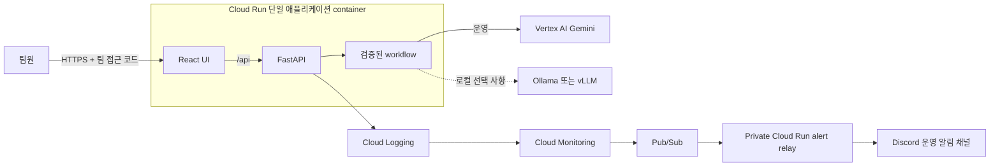
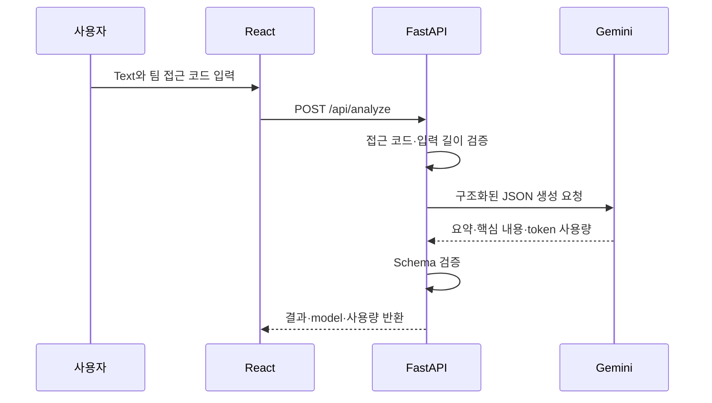
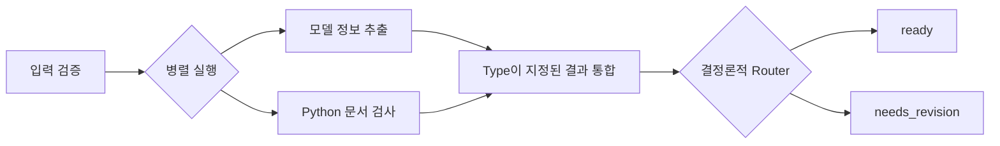
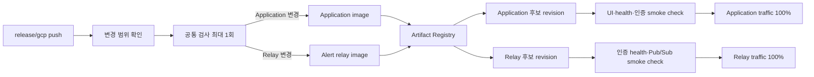

# 시스템 아키텍처

## 먼저 알아둘 핵심

| 항목 | 현재 결정 |
| --- | --- |
| 저장소 | Web, API, model runtime, infrastructure를 한 저장소에서 관리 |
| 운영 배포 | React·FastAPI 주 애플리케이션과 private 알림 relay를 별도 Cloud Run 서비스로 배포 |
| 운영 AI | Vertex AI의 Gemini 사용 |
| 로컬 AI | Mock이 기본이며 Ollama 또는 별도 vLLM GPU host를 선택적으로 연결 |
| 로컬 데이터 | PostgreSQL에 실습 record와 workflow 실행 metadata만 저장 |
| 배포 시작 조건 | `release/gcp` push에서만 CI와 CD 실행 |
| 비용 제한 | 주 애플리케이션 최대 instance 2, 알림 relay 최대 1, 두 서비스 모두 최소 0 |

운영 환경은 사용자 요청을 처리하는 application container와 운영 알림만 처리하는 작은 relay container로
구분합니다. 로컬에서는 수정과 실습이 쉽도록 web, API, DB를 분리합니다. Pub/Sub은 운영 알림 재시도에만
사용하며 application 작업 queue로 사용하지 않습니다. Kubernetes와 cloud database는 추가하지 않습니다.

## 전체 구성

사용자가 보는 Cloud Run URL에는 React 화면과 API가 함께 있습니다. 같은 origin을 사용하므로 운영
환경에 별도 frontend 배포나 CORS 설정이 필요하지 않습니다.

## 요청 처리 흐름

### 운영 화면의 `Analyze text`

- 접근 코드가 없거나 틀리면 Gemini를 호출하기 전에 `401`을 반환합니다.
- AI 호출 중지는 `503`, 인스턴스별 요청 한도 초과는 `429`로 반환하고 Gemini를 호출하지 않습니다.
- Gemini가 반환한 JSON이 schema와 맞지 않으면 성공 결과로 취급하지 않습니다.
- 일시적인 provider 오류만 제한된 횟수로 재시도합니다.
- 원문, 생성 결과, authorization header는 운영 log에 기록하지 않습니다.

### 로컬 graph workflow 실습

`POST /api/lab/workflow`는 로컬 mock 환경에서만 사용할 수 있습니다.

필수 section인 `일정`과 `준비`가 없으면 `needs_revision`으로 보냅니다. 이 판단은 사실성 검증이 아니라
문서 형식 검사입니다. 모델 추출과 Python 검사는 서로 독립적이므로 fan-out하고, 두 결과가 모두
성공한 뒤에만 join과 routing을 실행합니다.

## 실행 환경별 차이

| 환경 | 시작 방법 | Model | DB | 용도 |
| --- | --- | --- | --- | --- |
| 기본 로컬 개발 | `docker compose up -d` | Mock | PostgreSQL | UI/API 개발, graph·이력 실습 |
| 운영 형태 미리보기 | `docker compose up -d --build preview` | Mock | 사용 안 함 | 단일 container와 static UI 확인 |
| 로컬 Ollama 비교 | `ollama-check` profile | Mac의 Ollama | 사용 안 함 | 실제 로컬 model 품질 비교 |
| 모델 평가 관리 | `model-eval` profile | 호출하지 않음 | 사용 안 함 | suite·수동 검토 검증과 보고서 비교 |
| 로컬 모델 이력 연결 | `ollama-history-check` profile | Mac의 Gemma 4 | PostgreSQL metadata | 보고서와 동일한 실행 ID의 단계 이력 |
| 로컬 vLLM | 별도 Linux/NVIDIA profile | Gemma 계열 | 선택 | GPU 추론 실험 |
| GCP 운영 | `release/gcp` push | Gemini | Cloud DB 없음 | 팀 공유 demo |

로컬 개발에서는 Vite(`5173`)가 `/api`를 Uvicorn(`8000`)으로 proxy합니다. Source bind mount와 polling을
사용해 Docker Desktop과 WSL에서도 frontend HMR과 Python reload가 동작합니다. Cloud credential은 기본
개발 container에 mount하지 않습니다.

## 코드 책임

| 위치 | 책임 |
| --- | --- |
| `apps/web/` | 입력 화면, 결과 표시, 로컬 workflow 이력 UI |
| `apps/api/src/builder_cup/main.py` | HTTP route, 팀 접근 코드, request ID, 정제된 log, static UI 제공 |
| `apps/alert-relay/` | 인증된 Pub/Sub 알림을 허용 목록 Discord 메시지로 변환 |
| `schemas.py` | API 입출력 schema |
| `providers.py` | Gemini, vLLM, Ollama, Mock adapter |
| `workflow.py` | Timeout, retry, 생성 결과 검증, 사용량·비용 추정 |
| `graph_lab.py` | Fan-out, join, router로 구성된 로컬 graph 실습 |
| `database.py`, `history.py` | 로컬 PostgreSQL 연결과 workflow 이력 저장 |
| `models/vllm/` | API와 분리된 Linux/NVIDIA model runtime |
| `infra/gcp/` | GCP 기반 인프라를 정의한 Terraform |
| `scripts/` | Bootstrap, 배포, rollback, 평가와 운영 명령 |

Domain 계산과 규칙은 React나 prompt 안에 넣지 않고 workflow가 호출하는 Python 함수로 둡니다. 실제
agent 흐름이 필요해지면 이 workflow 경계 안쪽에 ADK를 도입합니다.

## PostgreSQL에 저장하는 것

| 저장 대상 | 저장 여부 |
| --- | --- |
| 합성 실습 record | 저장 |
| Workflow 상태, node timing, scenario, token metadata | 저장 |
| 사용자가 입력한 원문 | 저장하지 않음 |
| 모델이 생성한 본문 | 저장하지 않음 |
| Credential·접근 코드 | 저장하지 않음 |

스키마 변경은 파일명 순서의 SQL migration으로 적용하고 `lab.schema_migrations`에
버전·이름·SHA-256·적용 시각을 기록합니다. 각 파일과 버전 기록은 한 transaction에서 처리하며
적용된 파일의 checksum 변경을 거부합니다. 기존 volume을 삭제하지 않고 새 migration을 추가합니다.
API용 DB role은 필요한 table의 제한된 SELECT·INSERT·UPDATE 권한만 갖습니다.

`db-backup`은 role·ACL·비밀번호를 제외한 custom-format dump와 SHA-256 파일을 Git 제외
`backups/`에 생성합니다. `db-restore`는 기존 DB 덮어쓰기를 거부하고 명시적인 새
`builder_cup_restore_*` DB만 생성합니다. `db-recovery-check`는 원본·복원 table의 row count와
정렬된 JSON fingerprint, 앱 role 권한을 비교합니다. 이는 로컬 논리 백업 검증이며
지속적 백업·시점 복구·Cloud SQL 운영 구성이 아닙니다.

실행이 끝날 때 node snapshot을 한 번에 저장하므로 실시간 진행 상황은 제공하지 않습니다. Process가
강제 종료되면 `Running / unfinished` 상태가 남을 수 있습니다. Durable checkpoint와 자동 복구는 아직
구현하지 않았습니다.

## 모델 분리 원칙

| 원칙 | 이유 |
| --- | --- |
| API image에 PyTorch, CUDA, vLLM을 넣지 않음 | Web 배포와 GPU runtime의 크기·장비 요구사항을 분리 |
| Provider가 공통 schema를 반환 | Gemini와 로컬 model을 workflow 변경 없이 교체 |
| Cloud Run에서 laptop의 `localhost`에 연결하지 않음 | Cloud와 로컬 network는 직접 연결되지 않음 |
| 실제 추론은 CI에서 실행하지 않음 | 비용과 재현성 문제를 피하고 adapter contract만 test |

Ollama 비교는 고정된 합성 case를 사용하고 결과를 무시 대상인 `artifacts/`에 기록합니다. Model weight와
host runtime 설정도 Git에 넣지 않습니다. Cloud에서 별도 GPU host를 사용하려면 private network와
인증 방식을 추가로 설계해야 합니다.

## 배포 구조와 관리 주체

| 관리 주체 | 관리 대상 |
| --- | --- |
| Bootstrap script | GCS Terraform state bucket, demo secret 값, GitHub variable/environment |
| Terraform | API, Artifact Registry와 정리 정책, service account/IAM, Workload Identity, Secret metadata, monitoring, 선택적 budget |
| Release workflow | Application·relay image, Cloud Run revision, runtime 설정과 traffic |

주 애플리케이션은 public invoker를 사용하지만 relay는 public invoker를 허용하지 않습니다. Pub/Sub 전용
service account가 OIDC token으로 relay를 호출합니다. Discord webhook URL은 Secret Manager에만 있으며
relay runtime service account만 읽을 수 있습니다. Pub/Sub 전달이 5회 실패하면 dead-letter topic으로
분리되고 이메일 보조 알림이 발생합니다.

Cloud Run 서비스를 Terraform과 release workflow가 동시에 관리하지 않습니다. Secret 값은 Terraform
state에 넣지 않고 service-account JSON key도 만들지 않습니다. GitHub federation은 현재 저장소의 숫자
ID, `release/gcp` branch, push event로 제한합니다.

## 운영 한계와 보류 항목

- 주 애플리케이션은 최소 instance 0, 최대 2, instance별 concurrency 10입니다.
- 알림 relay는 최소 instance 0, 최대 1이며 인증된 Pub/Sub push만 받습니다.
- 팀 접근 코드는 demo 비용을 보호하는 공용 비밀번호이며 사용자별 인증 체계는 아닙니다.
- Token 기반 비용 추정은 근삿값입니다. 실제 비용은 Cloud Billing report에서 확인합니다.
- 현재 API contract는 **text 입력, 구조화된 text 출력**입니다.
- Image/audio, tool calling, retrieval, scheduler, durable job, cloud database는 주제 요구사항이 생긴 뒤 설계합니다.
- 오래 걸리는 작업은 request handler 안에서 실행하지 않고 Cloud Run Job 또는 durable queue worker로 옮깁니다.
