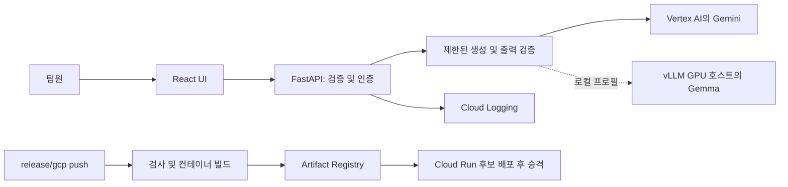

# 아키텍처 결정

## 단일 저장소, 단일 애플리케이션 배포

React/Vite는 UI를 담당하고 FastAPI는 모델 호출과 향후 Python 분석을 담당합니다.
개발 환경에서는 Vite가 `/api`를 프록시합니다. 배포 환경에서는 FastAPI가 컴파일된 UI를
같은 Cloud Run 컨테이너에서 제공합니다. 따라서 CORS 설정이나 별도 UI 배포가 필요하지 않습니다.

## 로컬 개발 및 검증

`docker compose up -d`는 Vite(`web`, 포트 5173)와 Uvicorn(`api`, 포트 8000)을 별도
서비스로 실행합니다. Vite는 `/api`를 Compose 서비스 호스트 이름으로 프록시합니다. 읽기 전용
소스 bind mount와 polling을 사용하므로 호스트 의존성을 공유하지 않고도 Docker Desktop/WSL에서
프런트엔드 HMR과 Python reload가 동작합니다. 공용 개발 이미지는 Node와 Python 도구를 모두
포함하지만 두 런타임의 책임은 별도 서비스로 유지합니다. 운영 이미지는 더 작은 단일 애플리케이션
컨테이너로 구성합니다.

Compose profile을 사용해 검증(`check`, `e2e`, `infra-check`)과 운영 방식의 `preview`를 기본
시작 대상에서 제외합니다. 로컬과 CI에서 같은 검증 명령을 사용합니다. 개발 환경은 항상 mock을
사용하고 클라우드 자격 증명을 mount하지 않으며, 공개 포트는 호스트 loopback에만 연결합니다.

### 로컬 PostgreSQL 실습 환경

기본 stack은 PostgreSQL 18.6도 실행하며 API보다 먼저 `db-init`을 수행합니다. 초기화 프로그램은
초기 `lab.records` schema와 제한된 `builder_lab` role을 transaction으로 생성합니다. 이는 반복
실행 가능한 초기화 과정이며 향후 schema 변경을 위한 migration engine은 아닙니다. 데이터가 있는
table을 변경할 때는 volume을 삭제하지 말고 명시적인 migration을 사용해야 합니다.

PostgreSQL 18 이미지의 데이터는 `/var/lib/postgresql`에 mount합니다. 다른 두 named volume에는
각각 생성된 관리자 비밀번호와 애플리케이션 비밀번호를 저장합니다. 관리자 secret은 DB 초기화
과정에서만 사용합니다. API role은 record를 SELECT·INSERT할 수 있지만 schema object를 만들거나
record를 삭제할 수 없습니다. 관리자 권한 없이 workflow history table을 SELECT·INSERT·UPDATE할
수도 있습니다.

로컬 mock 모드에서 명시적으로 활성화하면 `POST /api/lab/records`가 합성 record를 추가하고
`GET /api/lab/records/{id}`가 이를 조회합니다. 동기 handler의 DB 작업은 FastAPI thread pool에서
실행하며 connection/statement timeout을 제한하고 정제된 HTTP 503 오류를 반환합니다. 일반
`/api/health`는 애플리케이션 생존 여부만 확인하며 DB 준비 상태는 확인하지 않습니다. `db-check`는
API에서 PostgreSQL까지 실제로 데이터가 저장되는지 검증합니다. 이 실습 기능은 운영 preview에서
비활성화되고 Cloud Run에서는 거부되므로 클라우드 DB를 만들지 않습니다.

### 로컬 workflow 실습 환경

`POST /api/lab/workflow`는 DB 실습과 별개로 로컬 mock 모드에서만 활성화됩니다. `graph_lab.py`는
입력을 검증한 다음 모델 추출과 순수 문서 검사를 독립적으로 예약하고, type이 지정된 결과를 합친 뒤
결정론적 router를 적용합니다. 필수 section은 `일정`과 `준비`입니다. section이 없거나 비어 있으면
사실성 판단이 아니라 `needs_revision` 결과를 냅니다.

모델 branch는 기존 provider, timeout, retry, 출력 검증 contract를 재사용합니다. 문서 검사는
크기가 제한된 입력을 worker thread에서 처리합니다. 실패 시 대기 중인 async task는 취소합니다.
실행 중인 순수 검사는 worker thread에서 끝날 수 있지만 외부 side effect는 없습니다. join과 routing은
두 branch가 모두 성공한 뒤에만 실행합니다. event와 node timing에는 metadata만 들어가며 성공한
workflow response에 포함됩니다. 이 함수는 PostgreSQL 없이도 동작하며 graph database나 추가 agent
framework를 사용하지 않습니다.

### 작업 흐름 이력

로컬 실습 두 가지를 모두 활성화하면 `history.py`가 graph 실행을 PostgreSQL 저장 과정으로 감쌉니다.
`002_workflow_history.sql`은 초기화 중 `lab.workflow_runs`와 `lab.workflow_nodes`를 기존 데이터에
영향 없이 추가합니다. 실행 전 한 transaction에서 실행 중인 parent 하나와 대기 중인 node 다섯 개를
삽입하고, 종료 시 다른 transaction에서 최종 snapshot을 함께 commit합니다. DB 호출은 worker
thread에서 실행합니다. 시작 record 저장에 실패하면 모델을 실행하지 않고, 최종 저장에 실패하면
기록되지 않은 성공 결과 대신 오류를 반환합니다.

`GET /api/lab/runs`는 기본적으로 최근 실행 20개를 반환하며 limit 범위는 1~100입니다.
`GET /api/lab/runs/{id}`는 일관된 snapshot을 위해 parent와 node를 하나의 SQL 문으로 조회합니다.
React 이력 panel은 `/api/capabilities`를 사용해 이력 기능이 꺼져 있으면 자신을 숨깁니다. 실행 상태,
routing 결과, 소요 시간, 모델·prompt version, 시도 횟수, 보고된 token 수, 허용된 오류 code를 표시합니다.
원문과 생성 결과는 이 table에 저장하지 않습니다. provider가 사용량을 제공하지 않으면 null로 남고
UI에는 “Not reported”로 표시됩니다. 보고된 사용량은 전체 청구 금액이 아니며 보고되지 않은 실패
시도를 포함하지 않습니다. Mock은 token 수를 명시적으로 0으로 보고합니다.

Node snapshot은 실행 완료 또는 실패 시 저장하며 실행 중에 stream하지 않습니다. process가 강제
종료되거나 최종 DB 쓰기가 실패하면 실행 중인 parent와 대기 중인 node가 남을 수 있습니다. UI는 이를
“Running / unfinished”로 표시하며 새로고침 시 저장된 상태만 읽습니다. 영속 checkpoint, 자동 복구,
실시간 진행 표시는 아직 구현하지 않았습니다.

### 로컬 장애 연습

`WorkflowInput.scenario`의 기본값은 `normal`입니다. 다른 scenario는 request별 `ScenarioProvider`와
설정 복사본을 만들고 timeout을 1초, 최대 호출 수를 2회로 제한합니다. 공유 provider나 설정은 변경하지
않습니다. Timeout은 실제 async 대기를 사용하고, 잘못된 JSON은 기존 출력 validator를 통과하며,
일시적인 연결 오류는 기존 retry 정책을 거칩니다. Branch 실패 연습에서는 문서 검사가 추출 시작을
기다린 뒤 type이 있는 오류를 발생시킵니다. Graph 정리는 추출을 취소하고 join/routing을 건너뜁니다.
시뮬레이션은 외부 서비스에 연결하지 않습니다.

`003_workflow_scenario.sql`은 기존 row에 `normal` 값을 넣으면서 scenario column을 추가하고 데이터를
삭제하지 않습니다. 이력 panel은 scenario별 예상 결과와 저장된 scenario를 표시합니다.
`failure-check`는 실제 API와 PostgreSQL을 사용합니다. 예상한 HTTP 오류가 나더라도 저장된 run/node
상태까지 일치해야 성공으로 판정합니다. 기존 로컬 Mock 보호 장치는 모든 실습 route를 운영 preview에서
제외하고 Cloud Run 또는 실제 provider 설정에서 거부합니다. DB 쓰기 실패는 별도 persistence test로
검증하며 장애 연습은 DB를 중단하거나 다른 사용자의 request에 fault를 주입하지 않습니다.

## 코드 경계

- `schemas.py`: 애플리케이션 입출력 contract.
- `providers.py`: Gemini/vLLM/mock adapter. Provider는 HTTP response가 아니라 text와 사용량을 반환합니다.
- `workflow.py`: 생성 deadline, 제한된 일시적 retry, 출력 검증.
- `main.py`: HTTP, access code, request ID, 민감 정보가 제거된 운영 log, static UI.
- Domain 계산은 React나 prompt가 아니라 workflow가 호출하는 Python module에 둡니다.

이 작은 결정론적 workflow가 초기 graph입니다. 실제로 서로 독립적인 작업에만 fan-out을 추가하고,
의사결정 단계 전에 type이 지정된 결과를 join합니다. 규칙과 수치 계산은 일반 Python 함수로 유지합니다.
실제 agent flow가 생기면 workflow 경계 안쪽에 ADK를 도입할 수 있습니다. 범용 agent platform,
추측으로 만든 domain table, 동적 routing은 아직 설치하지 않았습니다.

## 모델 격리

선택 사항인 `ollama-check` 서비스는 합성 입력과 native Ollama adapter를 사용해 동일한 `run_graph`
함수를 실행합니다. Ollama는 Mac host에서 실행하고 container는 `host.docker.internal`을 통해 연결합니다.
Adapter는 원문을 보내기 전에 로컬 model metadata를 확인하고 cloud-backed model과 로컬이 아닌 endpoint를
거부합니다. Thinking과 streaming을 끈 JSON schema를 요청하고, 불완전하거나 잘린 응답을 거부합니다.
연결 실패는 fallback 없이 기존의 제한된 오류 정책을 따릅니다. 비교 조건은 context 4096, 생성 1024
token, temperature 0, 120초 이내 1회 시도로 고정합니다. Model digest와 함께 보고된 사용량 및 native
nanosecond 단위의 load/generation timing을 기록합니다.

비교 보고서는 무시 대상인 `artifacts/`에 timestamp가 붙은 JSON과 Markdown으로 생성되며, 고정된
합성 평가 case와 결과만 포함합니다. 이 실행은 PostgreSQL 이력 wrapper를 사용하지 않고 기본 Mock
UI/API도 변경하지 않습니다. 실제 추론은 CI에 포함하지 않으며 transport를 mock한 adapter test만
포함합니다. Mac server는 Ollama cloud 기능을 끄고 loopback에 bind합니다. Model weight와 host runtime
설정은 저장소 밖에 둡니다. Model의 5분 keep-alive가 유휴 추론 memory를 해제합니다.

API에는 PyTorch, CUDA, vLLM을 설치하지 않습니다. GPU 서비스는 별도 container와 model cache를
소유합니다. Model ID나 추론 host가 바뀌어도 web app을 다시 build하지 않습니다. 현재 API contract는
**text 입력, 구조화된 text 출력**입니다. Image/audio와 tool calling은 주제 선정 후 각각 검증된 contract가
필요합니다. Model이 지원한다는 이유만으로 해당 기능을 노출하지 않습니다.

GCP 배포에서는 Gemini를 provider로 사용합니다. 로컬 vLLM profile은 loopback endpoint 또는 SSH
tunnel을 사용합니다. Cloud Run은 개발자 노트북의 `localhost`에 연결할 수 없습니다. Cloud와 GPU를
연결하려면 별도로 설계한 private network와 인증 구성이 필요합니다.

## 인프라 소유 범위

- Terraform: 활성화할 API, Artifact Registry, identity/IAM, Workload Identity Federation,
  Secret Manager secret metadata, log metric, 운영 dashboard, 선택 사항인 billing budget.
- Bootstrap script: GCS state bucket, 생성된 demo secret 값, GitHub variable/environment.
- Release workflow: Cloud Run 애플리케이션 revision, runtime 설정, traffic, invoker IAM.
- 같은 Cloud Run 서비스를 Terraform과 release workflow에서 동시에 관리하지 않습니다.

State bucket은 자신의 state를 삭제하는 일을 막기 위해 Terraform 관리 대상 밖에 두며 versioning을
활성화합니다. Secret 값은 Terraform state에 들어가지 않습니다. Service account JSON key는 만들지
않습니다. GitHub federation은 숫자로 된 repository/owner ID, `release/gcp`, push event로 제한합니다.

## 운영 한계

Cloud Run은 최소 instance 0, 최대 instance 2, instance별 concurrency 10으로 설정합니다. 이 제한은
인프라 규모 증가를 막지만 **모델 비용의 절대 상한선은 아닙니다**. 공유 demo access code가 모델
request를 보호하지만 이는 prototype용 접근 장치이며 다중 사용자 identity system은 아닙니다. 더 넓게
공개하기 전에 사용자 인증, 사용자별 quota, 영속적인 rate limit을 도입해야 합니다.

Request에는 제한 시간이 있으며 일시적인 transport/provider 실패만 retry합니다. 원문, 모델 출력,
authorization header, credential file은 운영 log에 남기지 않습니다. Token 기반 비용 추정은 선택
사항이며 근삿값입니다. 실패한 시도와 다른 서비스 비용은 포함하지 않으므로 회계에는 billing report를
사용해야 합니다.

## 주제가 정해질 때까지 보류하는 항목

영속 domain storage, 일반 schema migration, durable job, scheduler, retrieval, 실시간 media, human
approval 정책은 요구사항이 생기기 전에 만들지 않습니다. 오래 걸리는 작업은 durable state와
idempotency를 갖춘 Cloud Run Job 또는 queue worker로 옮겨야 하며, request 범위의 FastAPI handler
안에서 fire-and-forget task를 시작하면 안 됩니다. PostgreSQL은 현재 합성 실습 record와 workflow
metadata만 저장합니다.
