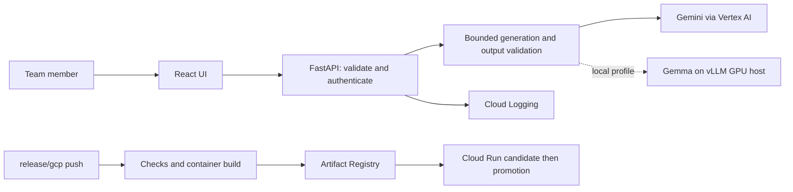

# Architecture decisions

## One repository, one application deployment

React/Vite handles the UI; FastAPI owns model calls and future Python analysis.
Vite proxies `/api` during development. In a release, FastAPI serves the compiled UI from
the same Cloud Run container. No CORS configuration or separate UI release is required.

## Local development and validation

`docker compose up -d` starts separate Vite (`web`, port 5173) and Uvicorn (`api`, port 8000)
services. Vite proxies `/api` to the Compose service hostname. Read-only source bind mounts and
polling enable frontend HMR and Python reload on Docker Desktop/WSL without sharing host dependencies.
A common development image contains Node and Python tools; the two runtime responsibilities remain
separate services. The production image remains the smaller, single application container above.

Compose profiles keep validation (`check`, `e2e`, `infra-check`) and production-style `preview`
out of the default startup. The same validation commands run locally and in CI. Development always
uses mock, does not mount cloud credentials, and binds published ports only to host loopback.

### Local PostgreSQL lab

The default stack also starts PostgreSQL 18.6 and runs `db-init` before the API. The initializer
creates the initial `lab.records` schema and restricted `builder_lab` role transactionally.
It is repeatable initialization, not a migration engine for future schema changes; evolve populated
tables through explicit migrations rather than deleting the volume.

PostgreSQL data is mounted at `/var/lib/postgresql` for the version 18 image. Two other named volumes
hold independently generated admin/app passwords. Only DB initialization sees the administrator secret.
The API role can SELECT and INSERT records but cannot create schema objects or delete records.

When explicitly enabled in local mock mode, `POST /api/lab/records` inserts a synthetic record and
`GET /api/lab/records/{id}` reads it. Synchronous handlers run DB work in FastAPI's thread pool, with
bounded connection/statement timeouts and sanitized HTTP 503 errors. General `/api/health` still checks
application liveness, not database readiness. `db-check` verifies actual API-to-PostgreSQL persistence.
The lab is disabled for production preview and rejected on Cloud Run; it introduces no cloud database.

## Code boundaries

- `schemas.py`: application input/output contracts.
- `providers.py`: Gemini/vLLM/mock adapters; providers return text and usage, not HTTP responses.
- `workflow.py`: generation deadline, bounded transient retries, output validation.
- `main.py`: HTTP, access code, request IDs, redacted operational logs, static UI.
- Domain computation belongs in Python modules called by workflows, not in React or prompts.

This small deterministic workflow is the initial graph. Add fan-out only for genuinely independent
work; join typed results before decision steps. Rules and numeric calculations remain ordinary
Python functions. ADK can be introduced behind the workflow boundary when a real agent flow exists.
No universal agent platform, speculative domain tables, or dynamic routing is installed yet.

## Model isolation

The API does not install PyTorch, CUDA, or vLLM. The GPU service owns its separate container and
model cache. Changing model ID or inference host does not rebuild the web app.
The current API contract is **text in, structured text out**. Image/audio and tool calling need their
own validated contracts after theme selection; model support alone does not expose those features.

Gemini is the GCP deployment provider. The local vLLM profile uses a loopback endpoint or SSH tunnel;
Cloud Run cannot reach a developer laptop at `localhost`. A cloud-to-GPU connection needs a separately
designed private network and authentication arrangement.

## Infrastructure ownership

- Terraform: enabled APIs, Artifact Registry, identities/IAM, Workload Identity Federation,
  Secret Manager secret metadata, logging metric, operations dashboard, optional billing budget.
- Bootstrap script: GCS state bucket, generated demo secret value, GitHub variables/environment.
- Release workflow: Cloud Run application revision, runtime configuration, traffic and invoker IAM.
- Never manage the same Cloud Run service in Terraform as well as this workflow.

The state bucket is outside Terraform to avoid destroying its own state. Its versioning is enabled.
The secret value never enters Terraform state. No service-account JSON key is created.
GitHub federation is restricted to numeric repository/owner IDs, `release/gcp`, and push events.

## Operational limits

Cloud Run starts at zero instances and caps at two instances, each with concurrency ten. These
limits contain infrastructure growth but are **not a hard model-spend cap**. A shared demo access
code protects model requests; it is a prototype gate, not a multi-user identity system.
Before broader distribution, introduce user authentication, per-user quotas and durable rate limits.

Requests are bounded; only transient transport/provider failures are retried. No raw source text,
model outputs, authorization headers, or credential files are emitted to operational logs.
Token-based cost estimation is opt-in and approximate; it excludes failed attempts and other services.
Use billing reports for accounting.

## Deferred until the theme requires them

Persistent domain storage, general schema migrations, durable jobs, scheduler, retrieval, real-time media, and
human approval policies are not invented ahead of requirements. Long jobs must move to Cloud Run
Jobs or queued workers with durable state and idempotency; do not launch fire-and-forget tasks inside
request-scoped FastAPI handlers. PostgreSQL currently stores synthetic lab records only.
