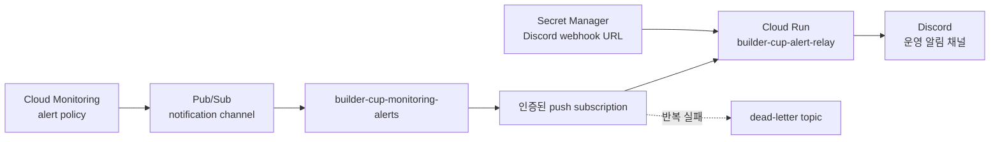

# Plan 01 Discord 운영 알림 중계기

작성일 **2026-09-23** · 상태 **실행 준비**

[현재 계획](README.md) · [운영 명령](../commands.md) · [GCP 인프라](../../infra/gcp/)

## 목적

Cloud Monitoring에서 발생한 장애를 Pub/Sub에 안전하게 전달하고, 전용 Cloud Run 중계기가 Discord 알림 형식으로 변환해 팀 채널에 게시합니다. 기존 웹·API 서비스와 알림 책임을 분리하고, Discord 장애나 일시적인 네트워크 오류가 있어도 Pub/Sub 재시도로 알림을 보존합니다.

## 현재 상태

2026-09-23 기준 상태입니다.

- Cloud Run `builder-cup` 서비스와 `/api/health`가 정상 동작합니다.
- Cloud Monitoring 대시보드 `Builder Cup operations`가 있습니다.
- 로그 기반 지표 `builder_cup_api_errors`가 있습니다.
- 월 ₩100,000 예산 알림이 설정되어 있습니다.
- uptime check, alert policy, Pub/Sub notification channel, Discord 중계기는 아직 없습니다.

예산 알림은 비용 증가를 알려줄 뿐 요청이나 배포를 자동으로 중단하지 않습니다.

## 선택한 구조



이메일은 Discord 경로 전체가 실패했을 때를 대비한 보조 채널로 유지합니다. Google Cloud는 webhook 계열 채널과 별도로 이메일 또는 Pub/Sub 같은 독립 경로를 함께 사용하도록 권장합니다.

## 구성 요소

| 구성 요소 | 제안 이름 | 역할 |
| --- | --- | --- |
| Monitoring notification channel | `builder-cup-discord` | alert policy 출력을 Pub/Sub topic으로 전달 |
| Pub/Sub topic | `builder-cup-monitoring-alerts` | 알림 이벤트 보관과 전달 분리 |
| Push subscription | `builder-cup-discord-relay` | OIDC 인증을 사용해 Cloud Run 호출 |
| Dead-letter topic | `builder-cup-monitoring-alerts-dlq` | 반복 실패한 메시지 격리 |
| Dead-letter subscription | `builder-cup-monitoring-alerts-dlq-inspect` | 실패 메시지를 7일 동안 확인 가능하게 보관 |
| Cloud Run service | `builder-cup-alert-relay` | Monitoring payload를 Discord 메시지로 변환 |
| Runtime service account | `builder-cup-alert-relay` | Discord webhook secret만 읽는 실행 계정 |
| Push service account | `builder-cup-alert-push` | relay에 `roles/run.invoker`로 호출하는 계정 |
| Secret Manager secret | `builder-cup-discord-webhook-url` | Discord webhook URL 보관 |

## 보안 경계

- relay Cloud Run 서비스는 public invoker를 허용하지 않습니다.
- Pub/Sub push는 전용 service account의 OIDC token으로 인증합니다.
- push service account에는 relay의 `roles/run.invoker`만 부여합니다.
- Pub/Sub service agent에는 push OIDC token 생성에 필요한 권한만 부여합니다.
- Monitoring notification service agent에는 알림 topic의 publisher 권한만 부여합니다.
- runtime service account에는 Discord webhook secret의 `roles/secretmanager.secretAccessor`만 부여합니다.
- webhook URL은 Git, Terraform 변수, Terraform state, GitHub Actions log에 넣지 않습니다.
- secret resource만 Terraform으로 만들고 secret version은 로컬에서 표준 입력으로 추가합니다.
- Discord 메시지와 운영 로그는 허용 목록 필드만 사용합니다.

Discord에 보낼 수 있는 필드는 다음으로 제한합니다.

- 장애 상태 `OPEN`, `CLOSED`
- alert policy 이름
- Cloud Run 서비스와 리비전
- 발생·복구 시각
- HTTP 상태 또는 오류 횟수
- Cloud Monitoring incident URL

사용자 입력, 모델 출력, API key, Discord webhook URL, 전체 Monitoring payload는 기록하거나 전송하지 않습니다.

## relay 동작 계약

relay는 Pub/Sub push envelope를 받아 `message.data`의 Monitoring incident JSON을 해석합니다.

1. OIDC 인증은 Cloud Run IAM이 처리합니다.
2. Pub/Sub envelope와 Base64 payload 형식을 검사합니다.
3. 허용된 incident 필드만 Discord 메시지로 변환합니다.
4. Discord가 HTTP 2xx를 반환하면 Pub/Sub에 HTTP 204로 응답합니다.
5. Discord timeout, 429, 5xx에는 HTTP 5xx를 반환해 Pub/Sub 재시도를 요청합니다.
6. 해석할 수 없는 payload는 오류 코드와 Pub/Sub message ID만 기록하고 실패 처리합니다.

Pub/Sub은 at-least-once 전달이므로 같은 알림이 드물게 중복될 수 있습니다. 별도 데이터 저장소를 추가하지 않고 Discord 메시지에 Monitoring incident ID와 상태를 표시해 중복을 식별합니다.

## 구현 범위

### 1. 전용 relay 애플리케이션

`apps/alert-relay/`에 기존 API와 분리된 작은 Python HTTP 서비스를 만듭니다.

- `/` Pub/Sub push 수신
- `/health` 컨테이너 상태 확인
- Discord 요청 timeout 설정
- 구조화된 안전 로그
- 독립 Dockerfile
- payload 검사, 메시지 변환, Discord 응답 처리 단위 테스트

기존 웹·API·모델 모듈은 import하지 않습니다. 공통화할 실제 중복이 없으므로 별도 공유 라이브러리도 만들지 않습니다.

### 2. Terraform 인프라

`infra/gcp`에 다음 리소스를 추가합니다.

- Pub/Sub API 활성화
- topic과 dead-letter topic
- 인증된 push subscription
- push·runtime service account와 최소 IAM
- Discord webhook Secret Manager resource
- Pub/Sub Monitoring notification channel
- uptime check와 alert policy
- 기존 `builder_cup_api_errors` 지표 alert policy
- dead-letter backlog 관찰 항목

재시도는 최소 10초, 최대 600초의 지수 backoff를 사용합니다. 5회 전달에 실패하면 dead-letter topic으로 보내고, 확인용 subscription에서 7일 동안 보관합니다.

### 3. 배포 workflow

relay는 기존 앱 이미지와 분리해 `builder-cup/alert-relay:<commit>` 이미지로 빌드합니다.

- `release/gcp`의 relay·인프라 관련 파일 변경 시에만 배포 workflow 실행
- 기존 Compose 검사와 relay 단위 테스트 통과 후 이미지 push
- `gcp` GitHub Environment 승인 후 배포
- Cloud Run은 `--no-allow-unauthenticated` 유지
- 배포 후 deploy service account의 identity token으로 `/health`를 확인
- 합성 Pub/Sub 메시지로 Discord 전달 smoke test

현재 WIF 조건이 `release/gcp` push만 허용하므로 relay workflow도 같은 조건을 사용합니다. 실제 배포 script는 기존 `deploy-gcp.sh`와 분리합니다.

### 4. Discord 준비

팀이 Discord에 운영 알림 전용 채널을 만들고 webhook을 생성합니다. webhook URL은 대화나 이슈에 붙이지 않고 다음과 같이 Secret Manager에 직접 추가합니다.

```bash
printf '%s' "$DISCORD_WEBHOOK_URL" |
  gcloud secrets versions add builder-cup-discord-webhook-url \
    --data-file=- \
    --project=stunning-crane-508614-c1
```

로컬 shell history에 URL이 남지 않도록 명령 인수에 webhook 값을 직접 쓰지 않습니다.
Cloud Run에는 배포 시점의 숫자 secret version을 연결하고 `latest`를 사용하지 않습니다. webhook을 교체하면 새 secret version 번호로 relay를 다시 배포합니다.

## 알림 정책

### 서비스 응답 실패

- 대상 `/api/health`
- 주기 5분
- 기대 HTTP 상태 200
- 여러 지역에서 확인
- 연속 2회 실패 시 `OPEN`
- 정상 응답 복귀 시 `CLOSED`

health check는 Gemini 요청을 보내지 않으므로 모델 비용을 발생시키지 않습니다. 응답의 `provider` 값은 설정 상태일 뿐 실제 Gemini 호출 성공을 증명하지 않습니다.

### API 서버 오류

- 지표 `builder_cup_api_errors`
- 5분 동안 1회 이상이면 `OPEN`
- 401은 정상 인증 거부이므로 제외
- 오류가 사라지면 `CLOSED`

### relay 전달 실패

- Cloud Run relay 5xx와 Pub/Sub dead-letter backlog 감시
- Discord 경로 실패는 이메일 채널로 알림
- webhook 폐기나 회전 시 secret version 교체 후 relay 새 리비전 배포

## 검증 계획

### 로컬 검사

1. 정상 Monitoring payload가 예상 Discord JSON으로 변환됩니다.
2. `OPEN`과 `CLOSED` 메시지가 시각적으로 구분됩니다.
3. 잘못된 Base64와 JSON이 안전하게 거부됩니다.
4. Discord 429, 5xx, timeout이 재시도 가능한 응답으로 변환됩니다.
5. 로그에 원문, 모델 출력, secret이 포함되지 않습니다.

### GCP 통합 검사

1. 인증 없는 relay 호출은 401 또는 403입니다.
2. push service account의 OIDC 호출만 relay에 도달합니다.
3. 합성 메시지를 topic에 발행하면 Discord 테스트 채널에 한 번 이상 도착합니다.
4. Discord webhook을 일시적으로 실패시키면 Pub/Sub가 재전달합니다.
5. 최대 시도 후 메시지가 dead-letter topic으로 이동합니다.
6. 실제 uptime alert의 `OPEN`과 복구 `CLOSED`가 Discord와 이메일에 도착합니다.
7. alert에서 Cloud Monitoring incident로 이동할 수 있습니다.

실제 장애 검증은 운영 서비스 중단 대신 별도 테스트 alert policy 또는 테스트용 relay 메시지를 사용합니다.

## 배포 순서

1. relay 코드와 단위 테스트 작성
2. Terraform 리소스와 IAM 추가
3. `terraform fmt -check`, `terraform validate`, Compose 검사 실행
4. Discord 채널과 webhook 생성
5. Secret Manager에 webhook secret version 추가
6. `release/gcp` 배포와 GitHub Environment 승인
7. 합성 Pub/Sub 메시지 smoke test
8. Monitoring alert policy에 Pub/Sub과 이메일 채널 연결
9. 장애·복구 통합 검사
10. 결과와 운영 명령 문서화

## 롤백

- 잘못된 알림이 반복되면 alert policy에서 Pub/Sub notification channel을 먼저 분리합니다.
- relay 배포 문제는 이전 Cloud Run revision으로 트래픽을 되돌립니다.
- webhook이 노출됐으면 Discord에서 즉시 삭제하고 새 webhook과 secret version을 만듭니다.
- 처리 불가능한 메시지는 dead-letter topic에 보존하고 정상 알림 흐름과 분리합니다.

## 완료 기준

- Monitoring → Pub/Sub → Cloud Run → Discord 경로가 Terraform과 코드로 재현됩니다.
- relay는 public 접근이 차단되고 OIDC 인증 push만 허용합니다.
- Discord webhook은 Secret Manager에만 저장됩니다.
- uptime과 API 오류의 발생·복구 알림이 Discord와 이메일에 도착합니다.
- Discord 장애 시 재시도와 dead-letter 처리를 확인했습니다.
- 알림과 로그에 사용자 입력, 모델 출력, credential이 없습니다.
- 팀원이 알림에서 incident와 Cloud Run revision을 식별할 수 있습니다.

## 예상 공수와 준비물

예상 구현 시간은 코드, Terraform, 배포, 실패 검증을 포함해 **4~8시간**입니다.

팀에서 준비할 항목은 다음 세 가지입니다.

1. Discord 운영 알림 채널
2. 해당 채널의 webhook을 만들 수 있는 권한
3. Discord 경로 실패를 받을 운영 이메일 주소

webhook URL 자체는 구현 전에 채팅으로 공유할 필요가 없으며, 배포 단계에서 Secret Manager에 직접 넣으면 됩니다.

## 참고 자료

- [Cloud Monitoring notification channel](https://docs.cloud.google.com/monitoring/support/notification-options)
- [Pub/Sub 인증 push subscription](https://docs.cloud.google.com/pubsub/docs/authenticate-push-subscriptions)
- [Pub/Sub retry policy](https://docs.cloud.google.com/pubsub/docs/subscription-retry-policy)
- [Pub/Sub dead-letter topic](https://docs.cloud.google.com/pubsub/docs/dead-letter-topics)
- [Cloud Run Secret Manager 연동](https://docs.cloud.google.com/run/docs/configuring/services/secrets)
- [Discord webhook 안내](https://support.discord.com/hc/en-us/articles/228383668-Intro-to-Webhooks)
