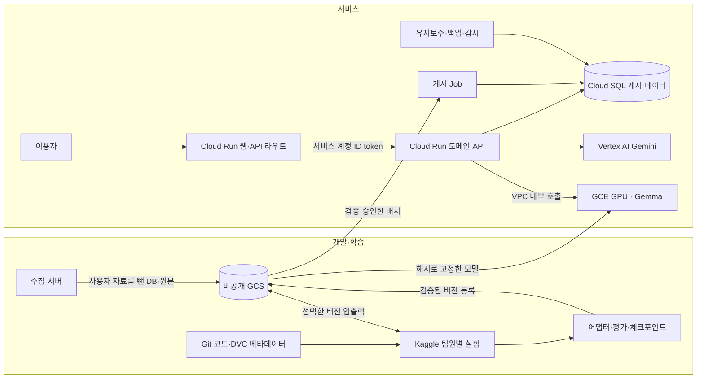

# Plan 17. Gemma·Gemini 하이브리드 인프라 구축

작성일 **2026-10-01** · 상태 **실제 운영 웹/API·Cloud SQL·GCE 시험·예약 작업까지 진척 – 팀 재현·승격·승인 게시·품질/데모 미완료** · 구축 목표 **10-12**, 통합 평가·데모 **10-15** · 제출 **10-18**

[계획 목록](README.md) · [10-02 실행 기록](17-hybrid-infrastructure-실행기록.md) · [확정한 아키텍처 제안서](../AI-개발/Gemma-Gemini%20하이브리드%20아키텍처%20제안서.md) · [현재 구현 점검](구현-완료도-실측-점검-2026-10-03.md)

## 2026-10-07 승인 배치 게시 기반 구현

불변 배치·항목 해시, 검수자 계정 승인, 뜻 판·사람 결정 충돌 검사, 뜻과 파생 출력·캐시의 원자적 게시, 활성 `publication_id`를 로컬 구현했다. Plan 19 overlay는 성공 게시된 항목과 게시 기록을 보존하고 새 표가 없는 이전 DB도 받는다. 웹 배치 검수·Cloud Run Job·전용 DB 역할·운영 migration/게시·복구 검증은 남는다. 이 기록으로 Plan 17의 최종 승인 게시 기준을 완료 처리하지 않는다. [도구와 검증 범위](../개발환경/승인-배치-게시.md)를 따른다.

## 2026-10-06 공개 조회·검수 경계 후속 구현

공개 사전·해석·챗봇 검색은 현재 승인된 verified 뜻만 읽고, 검수 대기 항목과 승인되지 않은 뜻 이력을 제외한다. 관리자 조회는 웹의 검수자 세션 확인과 API의 서버 토큰 검사를 모두 거친다. `status=all`은 공개 `/terms`에서 제거하고 보호된 `/review/terms`로 분리했다. 캐시와 예시 화면도 같은 기준으로 보완했다. 운영 배포·승인 변경 배치 게시는 별도로 남는다. 상세와 검증 결과는 [10-06 재점검의 후속 구현](구현-완료도-실측-점검-2026-10-06.md#재점검-후-바로-구현--공개-조회와-검수-권한-경계)을 따른다.

## 2026-10-06 재점검

10-03 점검 이후 단계 3·5는 실제 staging/production 구축, 단계 4는 기본 Gemma 실제 GCE·Cloud Run 연결 시험까지 진행했다. 단계 6의 예약 백업/복원·유지보수와 Plan 19 첫 DB 갱신도 기록돼 있다. 시험 VM은 삭제됐으며 운영 모델 승격은 아니다. 팀 재현·봉인 정답 비교·승인 배치 게시·최종 데모/복구 조건은 남는다.

최신 계획별 판정과 우선순위는 [10-06 재점검](구현-완료도-실측-점검-2026-10-06.md)을 따른다. 아래 날짜별 기록은 당시 범위로 보존한다.

## 2026-10-03 점검

최초 점검에서는 gateway/인프라 기반과 미커밋 API adapter·GPU VM·모델 설치를 구분했다. 후속 `4e237db`에서 GPU 코드가 커밋됐으며 실제 자원 구축은 남았다. 로컬 앱·학습·gateway·Terraform 검사는 통과했고, 최초 보안 실패는 의존성 13건 수정·개발 도구 1건의 기한부 예외 후 재검사에서 통과했다. 9개 최종 통합 기준의 체크는 유지하며 실제 GCP 자원·독립 사람 품질·팀 재현·승인 게시 완료로 올리지 않는다.

근거·검증 범위와 구현 적절성은 [10-03 점검 보고서](구현-완료도-실측-점검-2026-10-03.md)를 따른다. 아래 날짜별 결과는 당시 기록으로 보존한다.

## 1. 구축 목표와 결정

**팀원은 같은 버전의 데이터로 Kaggle에서 Gemma를 학습하고, 이용자는 GCP에 배포된 웹에서 Gemini·Gemma 서비스를 사용한다.** 개발자 PC가 꺼져도 게시된 사전과 사용자 기능은 계속 동작한다.

2026-10-01 사용자가 하이브리드 아키텍처를 채택했다. 이어 관리 지점을 줄이기 위해 웹도 GCP에 두기로 방향을 조정했다. 제안서의 학습·데이터·모델 분리는 적용하고, 웹·API는 Cloud Run으로 통합한다. 전체 수집 파이프라인은 현재 수집 서버에서 실행 중이며 최신 자료는 GCS로 인수한다. 현재 백업이 SQLite라는 이유로 수집 DB의 장기 유지 방침을 정하지 않는다. Plan 01의 PostgreSQL 전환 작업을 유지하고, 수집용 원자료/초안 DB의 위치·권한·백업 형식과 서비스 승인 DB의 경계를 실행 전에 확정한다. Colab은 사용하지 않는다.

| 책임 | 배치 위치 | 담당하는 일 |
| --- | --- | --- |
| 웹·사용자 세션·API 라우트 | **Cloud Run 웹 서비스**, `apps/trend-web` | Next.js 화면, 로그인·검수 권한 확인, 서버에서 백엔드 요청 |
| 도메인 API·모델 호출 조립 | **Cloud Run**, `apps/trend-api` | 사전·추천·생성·검수, 규칙 판정, 모델 호출 예산·동시성 |
| 관계형 서비스 데이터 | **Cloud SQL PostgreSQL** | 게시된 사전, 뜻 버전·검수·게시 기록, 보존 기간이 있는 사용자 자료 |
| 학습·전처리·실험 | **팀원별 Kaggle** | QLoRA, 평가, 체크포인트·어댑터·실험 결과 출력 |
| 데이터·모델 버전 | **Git + DVC + GCS** | Git에 코드·버전 메타데이터, GCS에 실제 데이터·가중치 |
| 도메인 특화 Gemma 추론 | **GCE GPU VM** | 감사·분류·편집 추론, 선택한 모델 버전 서빙 |
| 멀티모달·일반 생성 | **Vertex AI Gemini** | 제품 사진·문구 이해, 카피·대본 생성, 사전 질문의 자유 서술 |
| 게시·유지보수·감시 | **Cloud Run Job + Scheduler + Monitoring** | 승인된 배치 게시, 보존 정리·게시 상태·백업 점검·알림 |

웹과 API는 같은 GCP 프로젝트의 **별도 Cloud Run 서비스**로 둔다. 배포·IAM·로그·감시를 GCP에서 관리하면서 웹과 도메인 API의 책임을 분리한다. **Gemini 클라이언트는 계속 `model_client.py` 한 곳에서 Vertex AI 서비스 계정으로 생성한다.** 웹에 같은 모델 호출·규칙을 다시 구현하지 않는다.



## 2. 이미 확보한 자료

원본 인수 경로는 **`gs://copybara-team-shared-bucket/taewoo/trend-interpreter/`**다. 경로를 유지하고, 새 버전 관리·배포용 하위 경로를 추가한다. 폴더 이름은 업로드 위치이며 실제 소유권·IAM 권한은 별도로 확인한다.

10-01 읽기 전용으로 버킷 README, 해당 경로의 객체 목록·크기, 최신 DB 메타데이터와 모델 설정을 확인했다.

| 확인 항목 | 현재 기록 / 용도 |
| --- | --- |
| 전체 객체 | **287개, 57,091,566,217바이트 = 57.09GB / 53.17GiB**. 최초 75개·7.25GiB 이후 확대된 묶음 |
| 버킷 위치 | `ASIA-NORTHEAST1` |
| `db/` | 63개, 약 0.93GiB. SQLite·SQL 텍스트·과거본·표별 JSONL |
| `research/` | 77개, 약 51.88GiB. 학습·평가·어댑터·merged·GGUF |
| `raw/` | 145개, 약 0.37GiB. 캐시·씨앗·문서 대조·분류 작업 기록 |
| `db/latest/updated_at.txt` | `2026-10-01T16:15:22+09:00`, 수집 코드 `e499d6f`, **전체 표제어 11,235개** |
| 최신 DB 압축 파일 | `db/latest/trend-latest.db.gz` 71,103,301바이트. `table-counts.txt`에 용어·근거·뜻 등 41개 표의 건수 |
| 감사관 GGUF | `research/01-audit-finetune/gguf/audit-12b-v5-Q4_K_M.gguf`, 약 6.87GiB |
| f16 GGUF | 같은 경로의 `audit-12b-v5-f16.gguf`, 약 22.20GiB. 초기 제외 안내와 달리 **현재는 있음** |
| v5 어댑터 설정 | 기본 모델 `google/gemma-4-12B-it`, LoRA `r=16`, `lora_alpha=16`, `revision=null` |

업로더 설명과 README에 따르면 이용자 자료 `explain_cache`·`lookups`·`reader_prefs`와 `.env` 키는 제외됐다. 읽은 표별 건수 목록에도 세 표는 없다. 실제 DB 전체 내용·가중치의 무결성·추론은 아직 검사하지 않았다. 검수자 가명·문서 본문이 남아 있으므로 연구 자료는 비공개로 관리한다.

**SQL 텍스트는 `sqlite3 .dump` 산출물이다.** PostgreSQL의 `pg_dump`가 아니므로 Cloud SQL에 직접 복원하지 않는다. SQLite 스냅숏을 기존 이관 도구로 검증 이관하고, 이후 운영 PostgreSQL에서 별도 백업을 만든다.

## 3. 데이터 인수와 버전 관리

### 3.1 경로와 역할

기존 자료와 자동 업로드는 그대로 인수하고, 아래 네 경로를 추가한다. 모두 현재는 **생성 전인 계획 경로**다.

```text
taewoo/trend-interpreter/
├─ db/, research/, raw/, env/      기존 인수 자료·자동 백업
├─ snapshots/<snapshot-id>/       이관·학습에 선택한 고정 사본
├─ manifests/<snapshot-id>.json   객체 generation·해시·시각·행 수
├─ dvc-cache/                     DVC가 관리하는 콘텐츠 캐시
└─ releases/<model-version>/      승인 모델 명세·평가·배포 참조
```

- `db/latest/`는 하루 **12:45·22:45 KST** 갱신되는 인수 지점이다. `db/auto/`의 최근 28판(14일)은 수집 서버 복구용이다. 운영 DB와 학습은 선택한 `snapshots/`를 읽는다.
- 최신 파일들은 각각 업로드된다. 이번 목록에서도 `updated_at.txt`가 DB 파일보다 먼저 생성됐다. 잠금은 중복 실행을 막지만 여러 객체의 원자적 게시를 보장하지 않는다. 업로더는 **파일 업로드 → 건수/해시 검사 → manifest 마지막 게시** 순서로 보완한다.
- manifest에 `snapshot_id`, 수집 시각·코드 커밋, 각 객체 URI·generation·크기·CRC32C/SHA-256, 표별 행 수, 제외 표, 입력 스키마 버전을 둔다. 읽는 쪽은 manifest가 지정한 객체 판을 고정한다. 기존 객체의 덮어쓰기·28판 정리에 기대지 않고 선택 사본을 보존한다.
- 자동 업로드가 기존 DB를 매번 운영 DB에 덮어쓰게 만들지 않는다. 첫 전체 이관 이후에는 승인된 변경 배치만 게시한다.

### 3.2 DVC와 팀원 재현

개발 도구용 `uv` 프로젝트와 lockfile에 `dvc[gs]`를 고정하고 GCS remote를 `…/dvc-cache/`로 설정한다. `.dvc`·`dvc.yaml`·`dvc.lock`·원본 manifest·모델/프롬프트 버전은 Git에, 데이터·가중치·비밀 설정은 Git 제외 경로에 둔다. DVC의 GCS remote와 ADC 방식은 [공식 안내](https://doc.dvc.org/user-guide/data-management/remote-storage/google-cloud-storage)를 따른다.

처음부터 57GB 전부를 DVC 캐시에 복제하지 않는다. 인수 원본은 generation/해시로 참조하고, **학습/평가에 선택한 전처리셋과 채택 모델**부터 DVC로 등록한다. 일반 GCS 업로드 경로를 DVC remote로 지정했다고 기존 파일이 자동으로 DVC 객체가 되는 것은 아니다.

팀원의 재현 순서는 `git checkout <commit>` → 해당 `.dvc` 대상만 `dvc pull` → manifest 검증 → 학습/평가다. 개발 PC는 ADC, GCP 런타임은 서비스 계정, Kaggle은 비공개 Dataset 전달을 기본으로 한다. Kaggle에 장기 GCP 키나 운영 DB 자격증명을 넣지 않고, 실험 Output 회수·DVC 등록은 관리되는 개발 환경에서 수행한다. Kaggle 직접 GCS 접근은 별도 단기 인증이 검증됐을 때 추가한다.

**완료 기준:** 두 팀원이 같은 Git/DVC 버전에서 같은 입력 해시를 얻고, 필요한 대상만 내려받으며, 과거 버전도 다시 읽을 수 있다. 운영에서 참조 중인 모델·데이터가 GC나 자동 백업 정리로 사라지지 않는다.

## 4. Kaggle 학습과 모델 승격

### 4.1 학습 계약

첫 작업은 기존 **사전 감사관 재현**으로 잡는다. 기존 데이터·어댑터·평가 자료를 기준선으로 삼고, 추가 리스크·국가별 편집 작업은 데이터셋을 나눠 실험한다. 감사관 어댑터를 추천·카피 생성의 범용 모델로 사용하지 않는다.

| 입력 | 필수 산출물 |
| --- | --- |
| 데이터/DVC 해시, 학습·검증·최종 평가 분리 | 데이터 분할 명세, 평가 세트 해시 |
| 기본 모델 ID·정확한 revision·토크나이저 | `adapter_config.json`, 어댑터 파일, 모델 출처 |
| 프롬프트·chat template·추론 옵션 | 프롬프트 해시, 라이브러리 lockfile, 실행 코드 커밋 |
| GPU·세션 한도·학습 설정 | 시간·최대 VRAM·손실·실패 기록 |
| 재개할 실행 상태 | optimizer·scheduler·단계·난수 상태 포함 체크포인트 |
| 배포 후보 | 기본 모델 대비 품질·오탐/누락·형식 실패·속도 비교 |

기존 데이터에는 **Claude 판정 정답과 비어 있는 `human_*` 칸**이 있다. 모델 판정을 사람 정답으로 표시하지 않고, 용어·출처 단위로 겹침을 검사한 독립 사람 평가 세트를 별도로 둔다. 학습과 평가에 동일 용어의 변형이 섞이지 않게 한다.

인수한 기존 `audit_qlora.py`는 `save_strategy="no"`이고 마지막 어댑터만 저장한다. 새 `models/kaggle/audit/train.py`는 중간 체크포인트와 `resume_from_checkpoint`를 구현했고 실제 짧은 학습의 다음 버전 재개를 검증했다(10-02). 팀원 재현·전체 학습·독립 품질 평가는 남았다. 어댑터 저장은 학습 재개 체크포인트 저장과 다르다. 설치·모델·데이터 읽기부터 첫 추론과 짧은 학습까지 먼저 실행하고 라이브러리 버전을 고정한다.

### 4.2 배포 후보의 종류

| 산출물 | 서빙 경로 | 승격 전에 확인할 것 |
| --- | --- | --- |
| 현재 Q4 GGUF + `Modelfile.v5` | **첫 재현 경로: Ollama** | 모델 해시, template/parser, `ok/fix` 출력, 독립 평가 |
| 기본 모델 + LoRA 어댑터 | vLLM 지원 조합을 검증한 뒤 선택 | 정확한 기본 모델 revision·target modules·양자화·VRAM |
| merged safetensors / f16 GGUF | 변환·양자화 재현 및 후보 검증 | 원본→어댑터→merged→양자화 모델의 계보와 품질 차 |

현재 GGUF는 LoRA를 기본 모델에 합친 산출물이다. 여기에 같은 어댑터를 다시 적용하지 않는다. 팀원이 만든 여러 어댑터도 Git 병합으로 합쳐지는 가중치가 아니다. 실험별 후보를 비교해 한 버전을 선택한다.

버킷 README는 Ollama에서 `ok/fix` 대신 `fail`이 나온 문제를 기록한다. 현재 Modelfile의 `TEMPLATE {{ .Prompt }}`, `RENDERER gemma4`, `PARSER gemma4`와 학습 입력 형식을 먼저 맞춘다. **로딩 성공만으로 v5를 운영에 채택하지 않는다.**

제안서의 'GGUF를 vLLM에서 완벽히 지원'은 배포 보장으로 사용하지 않는다. [vLLM GGUF 문서](https://docs.vllm.ai/en/latest/features/quantization/gguf/)는 실험적 지원임을 명시한다. [LoRA 지원](https://docs.vllm.ai/en/latest/features/lora/)도 모델·양자화·어댑터 모듈 조합별 실제 검증이 필요하다. Ollama의 단일 GGUF import는 [공식 import 절차](https://docs.ollama.com/import)를 따른다. T4/L4 메모리에 양자화 파일이 들어간다는 것과 KV cache를 포함한 안정적 추론 가능성은 별도로 잰다.

**승격 기준:** 독립 평가에서 기본 모델보다 목표 지표가 개선되고, 형식 실패·민감 사례 누락이 악화되지 않는다. 사람 검토자가 평가 결과와 사용 범위를 승인한다. 개선되지 않으면 기본 Gemma를 운영하고 실험 결과를 남긴다. 기존 어댑터의 `revision=null`도 해소하거나 원본 가중치 해시로 정확한 계보를 고정한다.

## 5. GCP 서비스·네트워크·인증

### 5.1 자원 구성

GCP 서비스 프로젝트는 현재 `stunning-crane-508614-c1`, API·DB·GPU의 우선 지역은 `asia-northeast1`이다. 공유 버킷의 소유 프로젝트와 서비스 프로젝트 간 접근 권한은 실행 전에 확인한다.

| 자원 | 최초 구축안 | 확인 조건 |
| --- | --- | --- |
| VPC·서브넷 | API의 Direct VPC egress, GPU 내부 IP, Private Google Access | API→GPU 도달, 허용 서비스 밖 접근 거부 |
| GPU VM | **L4 1장·`g2-standard-8` 우선 후보**, T4는 비용/성능 비교 후보 | zone 공급·할당량·VRAM·정상 추론·승인 예산 |
| 모델 디스크 | 영구 디스크, 초기 200GB 제안 | 캐시·후보/이전 모델·임시 변환을 포함한 실제 공간 측정 |
| Gemma runtime | Ollama GGUF 재현부터, 이후 검증된 vLLM 프로파일 | 버전/digest 고정, 재시작·모델 교체·형식 검증 |
| 도메인 API | 인증 필수 Cloud Run, 처음 최대 2인스턴스 | DB 풀/동시성, 요청 예산, GPU 전체 동시성 제한 |
| Cloud SQL | 기존 `trend-project` 인수 여부 확정, PostgreSQL | 백업/PITR·보호 설정·역할 분리·복원 리허설 |
| 작업·감시 | 게시/유지보수/백업 Job, Scheduler, Monitoring | 예약 인증·실패 기록·Discord 전달 |

`g2-standard-8`의 L4 1장·24GB VRAM·32GB 호스트 메모리는 [GCE GPU 사양](https://docs.cloud.google.com/compute/docs/gpus) 기준이며 모델 적합성은 아직 미검증이다. GPU는 첫날 짧은 검증 뒤 사용 시간대를 정하고, 데모 전 충분히 예열한다. 1대 운영은 GPU 장애 시 실시간 특화 추론의 가용성을 보장하지 못하므로 화면은 게시본 읽기와 부분 실패 안내를 유지한다.

GPU에 외부 IP를 두지 않고 관리 접속은 IAP/OS Login으로 제한한다. 추론 엔진은 loopback에 바인딩하고, 인증하는 **내부 추론 gateway**만 API 전용 네트워크 태그/서브넷에서 받는다. 키를 검증하지 않는 Ollama 포트를 그대로 노출하지 않는다. gateway는 제한한 추론만 허용하며 모델 다운로드·삭제·임의 어댑터 로드 API를 이용자에게 열지 않는다.

모델 파일은 VM 로컬 디스크로 검증 다운로드한 뒤 읽는다. GCS FUSE의 네트워크 읽기에 GPU 초기 로드를 의존하지 않는다. 외부 패키지/모델 다운로드는 빌드 단계에서 수행하고, 런타임은 GCS·Artifact Registry·Google API 접근으로 줄인다. 필요한 일반 인터넷 egress만 Cloud NAT 대상으로 명시한다. Cloud Run 연결 방식은 [Direct VPC egress](https://docs.cloud.google.com/run/docs/configuring/vpc-direct-vpc)를 기준으로 구현한다.

### 5.2 권한 분리

| 실행 주체 | 필요한 권한 범위 |
| --- | --- |
| 팀 연구자·수집 업로더 | 지정 연구 경로 읽기 / 업로더의 지정 원본 경로 쓰기 |
| 웹 런타임 SA | 해당 Cloud Run API invoke, 웹에 필요한 secret만. DB·GPU·모델 가중치 직접 접근 없음 |
| API 런타임 SA | Cloud SQL 접속, Vertex 호출, 필요한 secret, 내부 추론 호출 |
| GPU 런타임 SA | 승인 모델 객체 읽기, 모니터링/로그. 운영 DB 쓰기 없음 |
| 게시 Job SA | 승인 배치 읽기, 정해진 PostgreSQL 게시 프로시저/역할 |
| 유지보수·백업 SA | 각 작업에 필요한 SELECT/DELETE·백업 경로 쓰기만 |
| 배포 SA | 검증 이미지/모델 배포·해당 런타임 SA 사용, 학습 데이터 변경 없음 |

GCS 문자열 prefix 자체는 IAM 경계가 아니다. 공유 버킷은 [managed folder](https://docs.cloud.google.com/storage/docs/managed-folders) 등 실제 접근 경계를 소유자와 구성하고 권한을 검증한다. 경계를 만들 수 없으면 운영 모델·백업 전용 비공개 버킷을 사용한다. 다른 팀 경로의 IAM·정리 정책을 이 계획에 묶어 바꾸지 않는다.

### 5.3 Cloud Run 웹 → API

웹은 공개 Cloud Run 서비스로, API는 인증 필수 서비스로 배포한다. 웹 런타임 SA에 해당 API의 `roles/run.invoker`만 부여한다. GitHub 배포는 기존 WIF를 사용하고 런타임 SA와 분리한다. staging 웹은 staging API 또는 sample 모드만 사용하며 production API invoke 권한을 갖지 않는다.

웹 서버는 **Cloud Run 메타데이터 서버에서 런타임 SA의 Google 서명 ID token을 발급받아**, API URL을 audience로 호출한다. 토큰은 서버에서 만료 전에 갱신·캐시하고 클라이언트로 보내지 않는다. GCP 밖의 개발 환경에서는 이 인증 헬퍼를 건너뛰고 기본 mock 스택을 사용한다.

웹의 공통 서버 fetch 헬퍼에서 모든 API 읽기·쓰기·스트리밍에 ID token을 붙인다. [Cloud Run 서비스 인증](https://docs.cloud.google.com/run/docs/authenticating/service-to-service)의 `X-Serverless-Authorization` 헤더를 사용할 수 있으며 기존 `x-frontend-token` 검수 권한은 함께 유지한다. Cloud Run invoke 인증과 실제 사용자/검수자 권한은 각각 검사한다. API의 첫 배포는 IAM 인증을 필수로 하고, ingress를 내부로 제한할 경우 웹→API의 VPC 라우팅까지 구성해 실제 연결을 검증한다.

웹은 기존 Next.js Dockerfile과 Node.js runtime을 사용한다. 사진은 현재 API의 **5MiB 한도**와 MIME 검사를 웹까지 맞추고 메모리에서만 처리한다. 긴 GPU 준비·배치 작업은 job ID와 상태 조회로 분리하고, 짧은 사용자 요청은 정해진 deadline·취소·부분 실패 응답을 제공한다. 웹·API의 timeout과 스트리밍 중단 동작을 함께 검증한다.

## 6. DB 이관·승인 게시·장애 처리

1. **원본 고정:** 한 snapshot manifest에서 SQLite 압축·표별 건수를 받아 무결성, 제외 표와 데이터 범위를 확인한다. 생성 결과와 사용자 문장을 운영 로그에 출력하지 않는다.
2. **staging 이관:** 새 PostgreSQL DB에 `migrate_sqlite_to_postgres.py --fresh --skip-user-data`를 사용한다. 제외/호환성 처리 건을 목록·건수로 남기고 용어·뜻·근거·검수 기록을 대조한다. 두 번째 전체 import를 기존 운영 DB에 덮지 않는다.
3. **신규 자료 게시:** 수집·Kaggle·GPU 출력은 `batch_id`, 입력 snapshot, 이전 뜻 버전, 모델/프롬프트/규칙 버전, 항목 해시와 승인 상태를 포함한 변경 배치로 만든다. 개인정보 원본은 포함하지 않는다.
4. **검증과 승인:** staging에서 스키마·근거·뜻/번역 버전·게이트를 검사하고 검수 큐에 올린다. 기존 사용자 승인 범위를 벗어난 변경은 사람이 승인해야 게시된다. 초안은 일반 조회·추천·생성 경로에서 차단하고 관리자 경로로 분리한다.
5. **트랜잭션 게시:** `publication_id`와 배치/항목의 유일키로 중복 실행을 막는다. 입력의 이전 뜻 버전이 현행과 다르면 충돌로 보류하고, 사람이 승인한 뜻·리스크·제외 상태를 보존한다. 뜻 변경은 새 판을 만들고 번역/관련 편집 결과의 버전을 맞춘다.
6. **마지막 정상본 유지:** 게시 데이터와 board/dashboard cache를 같은 게시 단위로 갱신하고 활성 `publication_id`를 마지막에 바꾼다. 실패한 배치의 일부가 일반 화면에 나오지 않게 한다. `/meta`와 감시는 활성 게시 성공 시각을 읽도록 바꾼다.

Gemma 특화 추론은 내부 gateway의 실제 readiness를 확인하고 deadline·큐 길이·GPU 전체 동시성을 제한한다. API 인스턴스별 세마포어만으로 VM 전체 한도를 지켰다고 판단하지 않는다. 최초 동시성은 1부터 실측하고 늘린다. `localhost` PC 폴백을 운영에서 제거한다. GPU 장애 시 게시 데이터 조회는 유지하고, 특화 작업은 보류/실패로 알린다. 일반 생성의 Gemini 장애는 기존 규칙에 따라 부분 결과나 오류로 응답한다.

운영 PostgreSQL 백업은 연구 버킷의 사용자 제외 SQLite 백업과 별도다. 운영 백업 전용 비공개 경로에 저장하고 실제 복원을 확인한다. 사용자 표를 포함한 복원 뒤에는 보존 기간 정리를 실행한다. Cloud SQL 체험 종료와 사양/비용 전환은 [Plan 13](13-cloud-sql-trial-to-paid-transition.md)에 연결한다.

## 7. 구현 순서와 산출물

아래 목표일은 팀 배정과 GPU quota 확인 후 확정할 실행안이다. DVC/학습과 웹/API 기반은 병행할 수 있고, 데이터·모델 승격은 독립 평가 뒤에 한다.

| 단계 | 목표일 | 구현 산출물 | 완료 확인 |
| --- | --- | --- | --- |
| 0. 자원·입력 확정 | 10-02 | snapshot manifest, GCP/bucket 권한표, GPU zone/quota와 비용 상한 | 같은 입력판 고정, 생성할 자원·권한·예산 확인 |
| 1. 데이터/DVC | 10-03 | 도구 lockfile, DVC remote/대상, 인수·검증 도구, 작은 재현 Dataset | 팀원 2명이 같은 해시로 읽기, 과거판 복원 |
| 2. Kaggle 재현 | 10-05 | 학습·평가 노트북, 체크포인트, 모델 lineage·품질 표 | 실표본 학습/재개, 보류 평가 세트 비교 |
| 3. API·DB 기반 | 10-06 | Terraform 네트워크/IAM/Cloud SQL 인수, secret 메타데이터, API 배포 도구 | staging 이관·복원, API 익명 거부 |
| 4. GPU 서빙 | 10-08 | GCE·디스크·runtime·내부 gateway, 모델 release manifest | GGUF 실제 추론, 동일 프롬프트 재현, VRAM/시간/형식 검사 |
| 5. 웹 연결 | 10-09 | Cloud Run 웹·공통 인증 fetch·환경 설정·스트리밍/취소 | 웹 SA 허용·staging/익명 거부, API 모드 사용자/관리자 흐름 |
| 6. 게시·운영 | 10-12 | 배치/게시 migration·Job, 유지보수/백업/Scheduler·경보 | 중복·오래된 배치·실패 주입, PC 중단, 복원·알림 |
| 7. 배포·평가·데모 | 10-15 | 승인 모델/데이터/웹/API 버전 묶음, 복구 기록, Plan 09 평가·시나리오 3개 | 같은 release에서 재현, Gemini/Gemma 실제 호출과 비용 확인 |

책임은 **데이터 인수·학습 / 모델 runtime / API·DB·인프라 / 웹·세션 / 품질 검수**로 나눈다. 담당자 이름과 승인 예산은 실행 기록에 채운다.

예정 코드 위치는 `infra/gcp`(리소스), `models/kaggle`(학습), `models/serving`(GPU runtime·gateway), `scripts`(인수/DVC/배포), `apps/trend-api`(모델 adapter·게시·Job), `apps/trend-web`(인증 fetch·화면)다. 현재 `models/vllm`의 E2B 예시를 12B 감사관 배포로 간주하지 않는다. 런타임별 버전과 설정을 별도 프로파일로 고정한다.

## 8. 배포·비용·복구 기준

- 개발은 `develop`. production은 **`release/gcp`의 검증된 커밋**을 기준으로 GPU 모델·Cloud Run API·Cloud Run 웹을 함께 기록한다. 웹/API 이미지 빌드·배포·검증을 같은 승인된 release workflow에서 실행한다.
- 배포 전 `docker compose run --rm --build check`, `docker compose run --rm --build e2e`, `docker compose run --rm infra-check`를 통과시킨다. sample 검사 외에 staging API 모드 흐름·실제 모델 smoke·보류 품질 평가를 별도로 완료한다.
- Terraform으로 공유 버킷 전체를 새로 선언하거나 Cloud SQL을 중복 생성하지 않는다. 기존 자원의 소유 범위를 확인하고 필요하면 import한 뒤 무변경 plan을 먼저 검토한다. secret 값·credentials·모델·TF state는 Git 밖에 둔다.
- Plan 05의 관련 내구성·비공개 API·유지보수·복구 조건과 이 계획의 인증 경로를 구현한 뒤 Trend deploy job을 활성화한다. 기존 `builder-cup`은 새 production의 실제 동작과 복구가 확인될 때까지 유지한다.
- release manifest는 웹/API 이미지 digest와 Cloud Run revision·DB 스키마/게시 ID·모델 해시·데이터 snapshot·평가 결과를 묶는다. 후보 API revision과 후보 모델을 먼저 검사하고 호환되는 웹 revision을 마지막에 승격한다. 실패 시 호환되는 이전 웹/API/모델로 복구한다. 의미/검수 이력을 DB 복원으로 지우지 않고, 데이터 복구는 별도 승인 변경/복구 절차로 수행한다.
- 운영 로그는 요청 ID·모델/배치/버전·소요 시간·건수·오류 코드만 허용한다. 프롬프트·생성 결과·사용자 문장·키와 token은 남기지 않는다. 실험 상세 결과는 접근 통제한 연구 산출물에 둔다.
- 비용은 GPU/VM 가동 시간, 디스크, Cloud Run 웹/API/Job, Cloud SQL, GCS 저장/버전/전송, Cloud NAT, Gemini, 감시/빌드를 함께 산정한다. GCS→Kaggle 반복 다운로드도 포함한다. **예산 알림은 자동 지출 차단이 아니다.** GPU 예약 종료·호출 상한·최대 인스턴스·업로드 보존 규칙을 별도 구현한다.

이 문서는 구축 계획이며 실제 자원 생성·배포·GPU 시험 기록은 [실행 기록](17-hybrid-infrastructure-실행기록.md)과 [10-06 재점검](구현-완료도-실측-점검-2026-10-06.md)으로 구분한다. 추가 실행 전 확인할 값은 **웹/API 동시성·timeout·인스턴스 상한, GPU zone/quota·가동 시간·지출 상한, Cloud SQL 인수/사양·네트워크, 권한을 부여할 공유 버킷 소유 주체, 최초 채택 모델 버전**이다. GCP 자원 생성·배포·결제는 저장소의 기존 사용자 확인 절차를 따른다.

## 9. 최종 완료 기준

- [ ] 팀원 두 명이 Git/DVC의 같은 버전에서 같은 데이터로 Kaggle 실표본 학습·재개를 재현한다.
- [ ] 모델 계보·기본 모델 revision·프롬프트·독립 평가·승격 결정이 추적된다.
- [ ] GCE에서 선택 모델이 실제 추론하고, PC/Kaggle 없이 동일 결과 형식·성능 기준을 만족한다.
- [ ] Cloud Run 웹에서 실데이터 사전→사진/문구 추천→생성이 동작하며 Gemini 호출은 Vertex AI로 기록된다.
- [ ] API 익명 요청·staging의 production 접근·GPU 비인가 요청·일반 사용자의 검수 쓰기가 거부된다.
- [ ] 승인 배치만 게시되고 중복·오래된 입력·실패 배치·사람 결정 보호가 검증된다.
- [ ] GPU 중단에도 사전 조회가 유지되고, PC 중단에도 마지막 정상 게시 시각·오래됨 표시가 정확하다.
- [ ] 운영 DB 백업·복원·보존 정리·예약/경보·이전 release 복구를 실제 실행했다.
- [ ] Plan 09의 품질 결과와 배포본 데모 3개, 사용 비용과 미검증 범위를 기록했다.

## 10. 기존 계획의 연결

| 기존 계획 | 이번 결정의 적용 |
| --- | --- |
| 01 | 원작자 PC 파일 수령 대신 GCS의 고정 snapshot을 인수. PostgreSQL 대조·전환 조건 유지 |
| 05 | 웹/API는 별도 Cloud Run, DB·Job도 GCP. 내구성·비공개 API·유지보수·복구 조건 유지 |
| 06 | Kaggle QLoRA + DVC/GCS 버전 관리 + 승인 게시. 운영 추론은 GCE GPU로 연결 |
| 09 | 학습 전후와 양자화/서빙 전후를 구분해 평가. 배포본에서 데모 재현 |
| 11 | GitHub 배포 WIF·Environment 승인과 웹/API 런타임 SA를 분리. 공개 전환 시 연구 객체 접근은 계속 제한 |
| 13 | 기존 Cloud SQL 체험 종료·사양·비용 결정을 유지 |
| 14 | GPU 위치는 GCE로 확정. 사용자에게 보이는 분류/모델 기록·관리자 실행 UX는 이 기반 위에서 구현 |
| 12·15·16 | 수집·검수·시기/성향 데이터는 입력 자산. 대량 등재 완료와 모델 품질/승격은 별도 확인 |


### 당시 충돌 정리와 남은 구현 (2026-10-01)

01·05·06·14의 실행 본문과 완료 기준을 이 결정에 맞췄다. 이전 실측·실험 결과는 날짜가 붙은 과거 기록으로 보존한다. 아래 문서 정리는 완료됐지만 코드·자원 구축이 완료된 것은 아니다.

| 경계 | 정리한 계획 | 아직 구현·검증할 것 |
| --- | --- | --- |
| 데이터 인수 | 현재 GCS SQLite 백업을 staging 이관, 수집 DB의 PostgreSQL 전환 작업 유지 | manifest 마지막 게시·generation/해시 검증·최신 DB 대조, 이관 `--skip-user-data`의 `lookups` 제외 보완 |
| 학습·버전 관리 | Kaggle을 팀 재현 경로로, DVC/GCS를 버전 원본으로 사용 | DVC lockfile/remote, Dataset 전달·Output 등록, 학습 체크포인트·재개 |
| 모델 서빙 | Cloud Run GPU와 유휴 비용 0 가정 대신 GCE GPU·인증 gateway | runtime adapter, readiness·전체 동시성·deadline, 작업별 모델 품질, 가동 종료 |
| 승인 게시·신선도 | 승인 배치 Job, 초안 공개 금지, 활성 publication 기준 | 게시 migration·트랜잭션·버전 충돌 보호, 공개 조회 게이트, `/meta`·유지보수 소비자 전환 |
| 서비스·복구 | Cloud Run 웹/API 유지, 운영 PostgreSQL 예약 백업 추가 | ID token 공통 fetch, 배포 workflow, 백업·복원·보존 정리와 경보 |

이 작업들은 Plan 17의 단계 0~7에 배치한다. 17번은 위 계획들을 모두 끝낸 뒤 시작하는 후속 계획이 아니다.
