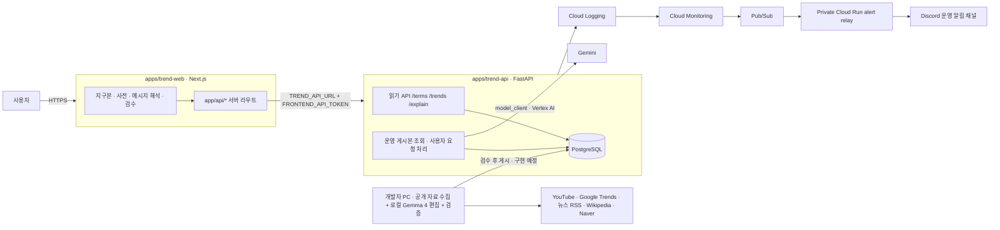
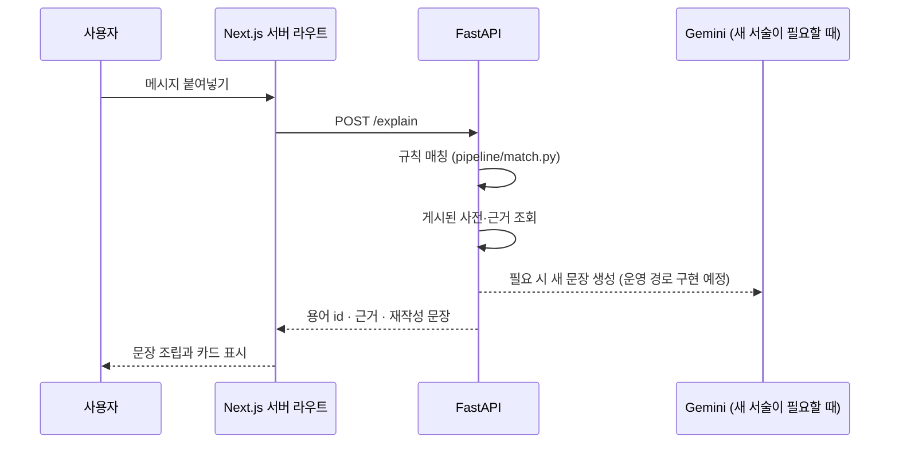
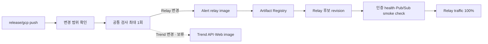

# 시스템 아키텍처

## 먼저 알아둘 핵심

| 항목 | 현재 결정 |
| --- | --- |
| 저장소 | Web, API, model runtime, infrastructure를 한 저장소에서 관리 |
| 제품 | 세대·나라를 건너 유행어·밈을 해석하는 **트렌드 통역** (`apps/trend-web`, `apps/trend-api`) |
| 운영 AI | Vertex AI의 Gemini. 런타임 service account로 접속하며 API key를 쓰지 않음 |
| 로컬 AI | 개발자 PC의 Gemma 4가 공개 자료 분류·사전 언어판·국가별 해석 초안을 만들고 검수 후 운영 DB에 게시할 계획 |
| 데이터 | 관계형 데이터는 모두 PostgreSQL. 로컬은 Compose `db`(`postgres_data` 볼륨), 운영은 Cloud SQL 예정. 웹은 기본 예시 데이터 모드 |
| 운영 배포 | `release/gcp`에서 알림 relay와 Trend 웹·API를 배포(2026-10-04부터). Trend는 후보 revision 검사 뒤 트래픽을 옮긴다 ([Plan 05](../plans/05-trend-cloud-run-deployment.md)); 전체 파이프라인·GPU 서비스는 배포 대상에서 제외 |
| 기존 서비스 | 이전 실습 앱 `builder-cup` Cloud Run은 Trend production 확인 뒤 2026-10-04에 삭제 |
| 비용 제한 | 알림 relay 최대 instance 1·최소 0. Trend 앱은 배포 설계 시 확정 |

## 전체 구성

브라우저는 API를 직접 부르지 않습니다. 화면은 같은 origin의 Next.js 서버 라우트(`app/api/*`)를 부르고,
서버 라우트가 세션과 권한을 확인한 뒤 서버만 아는 `FRONTEND_API_TOKEN`을 붙여 API에 전달합니다.
`DATA_MODE`와 `TREND_API_URL`은 서버 환경변수라 브라우저에 나가지 않습니다.

## 요청 처리 흐름

### 메시지 해석 (`/explain`)

- 판정은 데이터가 합니다. 생애주기·검증 상태는 규칙 코드가 정하고 LLM은 서술만 합니다.
- 사전에 묻기(`/ask`)는 읽기 전용 도구 호출 루프입니다. 모델은 `pipeline/tools.py`의 도구로만 사전을 봅니다.
- 원문, 생성 결과, 토큰 값은 운영 log에 기록하지 않습니다.

### 파이프라인

`scripts/run_pipeline.py`가 collect → classify → spikes → interpret → candidates → spot → hunt → research →
track → naver → translate → topics → board 순서로 실행합니다. 이 전체 파이프라인은 개발자 PC에서 실행하고 검증된 결과를 Cloud SQL에 게시할 계획입니다. 각 단계는 PostgreSQL 표를 읽고 쓰며 예외를 삼켜
`pipeline_runs`에 기록하므로 한 단계의 실패가 다음 단계를 막지 않습니다. 단계 설명은
[파이프라인 기록](../트렌드/파이프라인.md)에 있습니다.

## 모델 호출 경계

| 설정 | 로컬 기본값 | 의미 |
| --- | --- | --- |
| `MODEL_PROVIDER` | `mock` | `vertex`일 때만 Gemini 클라이언트를 만듦 |
| `MODEL_REQUESTS_ENABLED` | `false` | `true`가 아니면 어떤 Gemini 호출도 하지 않음 |
| `GCP_PROJECT_ID`, `GOOGLE_CLOUD_LOCATION` | 비움 | Vertex AI 대상 프로젝트·위치 |
| `GEMINI_DAILY_BUDGET` | `36` | DB `gemini_calls` 장부로 세는 하루 호출 상한 |
| `ADK_MODEL` | Gemini | `local`이면 ADK 에이전트도 로컬 모델(LiteLLM) 사용 |

Gemini 클라이언트는 `src/trend_agents/model_client.py` 한 곳에서만 만듭니다. 파이프라인은 `pipeline/gemini.py`를
거쳐 예산·재시도·폴백 모델을 적용하고, 해석기(`interpreters/gemini_*.py`)와 ADK 팀(`agents/team.py`)도 같은
클라이언트를 씁니다. 두 설정이 모두 켜지지 않으면 `ModelRequestsDisabled`로 끝나며 비용이 발생하지 않습니다.
ADK 에이전트는 예산 가드 콜백에서 같은 조건을 확인해 모델 호출 전에 짧은 응답으로 대체합니다.

## 실행 환경별 차이

| 환경 | 시작 방법 | Model | 데이터 | 용도 |
| --- | --- | --- | --- | --- |
| 기본 로컬 개발 | `docker compose up -d` | 호출 없음 | 웹 예시 데이터, Compose PostgreSQL | 화면·API 개발 |
| 실데이터 로컬 | `DATA_MODE=api docker compose up -d` | 호출 없음 | Compose PostgreSQL | 파이프라인 결과 확인 |
| 로컬 Gemma | Ollama 또는 vLLM + `LOCAL_LLM_BASE_URL` | Gemma 4 | Compose PostgreSQL | 번역·재작성·분류 실측 |
| 배포 이미지 확인 | `docker build` + `scripts/container-smoke.sh` | 호출 없음 | 일회용 PostgreSQL 컨테이너 | CI와 같은 이미지 검증 |
| GCP 운영 | 보류 | 요청 시 Gemini (Vertex AI), 게시본은 로컬 Gemma 편집 | Cloud SQL PostgreSQL 예정 | [Plan 05](../plans/05-trend-cloud-run-deployment.md)·[Plan 06](../plans/06-gemma-on-cloud-run-gpu.md) |

로컬 개발에서는 Next.js dev server(`3000`)와 Uvicorn(`8000`)이 별도 컨테이너에서 실행됩니다. Source bind mount와
polling을 사용해 Docker Desktop과 WSL에서도 Fast Refresh와 Python reload가 동작합니다. Cloud credential은
기본 개발 container에 mount하지 않습니다.

## 코드 책임

| 위치 | 책임 |
| --- | --- |
| `apps/trend-web/app/` | 화면과 서버 라우트. `proxy.ts`가 `/me`·`/admin` 접근을 세션으로 제한 |
| `apps/trend-web/lib/data.ts` | 화면이 부르는 유일한 데이터 접근 계층. 예시 데이터와 API 모드 전환 |
| `apps/trend-web/lib/contract/` | `schemas.py`에서 생성한 JSON Schema와 TS 타입. 손으로 고치지 않음 |
| `apps/trend-api/src/trend_agents/api/app.py` | HTTP route, 계정 인증, 검수 기록 |
| `apps/trend-api/src/trend_agents/schemas.py` | 수집·해석·사전 모델의 계약 |
| `apps/trend-api/src/trend_agents/model_client.py` | Vertex AI Gemini 클라이언트 생성과 호출 차단 |
| `apps/trend-api/src/trend_agents/pipeline/` | 단계별 파이프라인, 규칙 매칭, 도구 호출 루프 |
| `apps/trend-api/src/trend_agents/collectors/` | 외부 데이터 소스 수집기 |
| `apps/trend-api/src/trend_agents/interpreters/` | Gemini·로컬 Gemma 호출 |
| `apps/trend-api/src/trend_agents/storage/` | PostgreSQL 어댑터·연결 풀·마이그레이션(`db.py`, `migrations/`)과 저장소. Spanner Graph DDL은 제출 범위 밖 |
| `apps/alert-relay/` | 인증된 Pub/Sub 알림을 허용 목록 Discord 메시지로 변환 |
| `models/vllm/` | API와 분리된 Linux/NVIDIA model runtime |
| `infra/gcp/` | GCP 기반 인프라를 정의한 Terraform |
| `scripts/` | 릴리스 분류, smoke 검사, 배포, rollback |

## PostgreSQL에 저장하는 것

| 저장 대상 | 저장 여부 |
| --- | --- |
| 수집한 영상·검색어·뉴스 메타데이터와 URL | 저장 (영상 파일은 받지 않음) |
| 사전 항목, 뜻의 version 이력, 근거 발췌 | 저장 (삭제하지 않고 version을 닫음) |
| 검수 결정과 결정자 계정 이름 | 저장 |
| 로그인한 사용자의 세대·나라 설정 | 저장 |
| 해석을 요청한 문장, 사전에 없던 표현 | 저장 후 7일·30일이 지나면 삭제 |
| Gemini 호출 횟수 장부 | 저장 |
| 비밀번호 평문, API key, 세션 비밀값 | 저장하지 않음 (계정은 PBKDF2 해시만) |

표는 TEXT·BIGINT·DOUBLE PRECISION 컬럼과 JSON 문자열로 구성되며 Pydantic 모델을 통째로 저장합니다. 저장소 함수는
`?` 자리표시자와 `INSERT OR REPLACE`를 그대로 쓰고 `storage/db.py` 어댑터가 psycopg 형식과 `ON CONFLICT`로 바꿉니다.
운영에서는 같은 스키마를 Cloud SQL PostgreSQL에 두며, 인스턴스 준비는 Plan 05에서 진행합니다.
기존 표의 변경은 `storage/migrations/`의 번호 붙은 SQL 파일로 하고 `schema_migrations`에 적용 기록을 남깁니다.
API는 `psycopg_pool` 풀(`DB_POOL_SIZE`)에서 요청마다 연결을 빌리며, 풀 크기와 Cloud Run 동시성을 같게 둡니다.
사용자가 입력한 문장은 해석 캐시에 7일, 미해결 질문에 30일만 보관합니다.

## 모델 분리 원칙

| 원칙 | 이유 |
| --- | --- |
| API image에 PyTorch, CUDA, vLLM을 넣지 않음 | Web 배포와 GPU runtime의 크기·장비 요구사항을 분리 |
| 로컬 모델 호출은 `interpreters/local_chat.py` 한 곳 | Ollama와 OpenAI 호환 서버를 같은 코드로 교체 |
| Cloud Run에서 laptop의 `localhost`에 연결하지 않음 | Cloud와 로컬 network는 직접 연결되지 않음 |
| 실제 추론은 CI에서 실행하지 않음 | 비용과 재현성 문제를 피하고 코드 계약만 test |

## 배포 구조와 관리 주체

| 관리 주체 | 관리 대상 |
| --- | --- |
| Bootstrap script | GCS Terraform state bucket, secret 값, GitHub variable/environment |
| Terraform | API, Artifact Registry와 정리 정책, service account/IAM, Workload Identity, Secret metadata, monitoring, budget |
| Release workflow | Relay image, Cloud Run revision, runtime 설정과 traffic |

Trend 앱의 Cloud Run 서비스·secret·한도는 `infra/gcp/hybrid`가, 모니터링은 root `infra/gcp`가 관리합니다. uptime check는
`trend-production-web`의 `/map`을, 오류 경보는 Trend 웹·API의 5xx를 감시합니다(2026-10-04). Cloud Run 서비스를 Terraform과 release workflow가 동시에
관리하지 않습니다. Secret 값은 Terraform state에 넣지 않고 service-account JSON key도 만들지 않습니다.

## 운영 한계와 보류 항목

- Trend 앱은 아직 GCP에 배포하지 않았습니다. Cloud SQL 인스턴스, 비공개 API 경로, secret 목록이 준비 대상입니다.
- 웹의 계정은 `.env`의 `ACCOUNTS`(PBKDF2 해시)이며 사용자별 인증 체계(Firebase Auth 등)는 아직 아닙니다.
- Gemini 하루 예산은 DB 장부 기준이며 월 과금 상한이 아닙니다. 실제 비용은 Cloud Billing과 [GCP 운영](GCP-운영.md)의 예산 알림으로 확인합니다.
- 전체 수집·해석 파이프라인은 개발자 PC에 두고, 검수된 결과만 운영 DB에 게시할 계획입니다. 사용자 입력 보존 기간 정리와 건강 점검은 PC와 독립적으로 구현해야 합니다.
