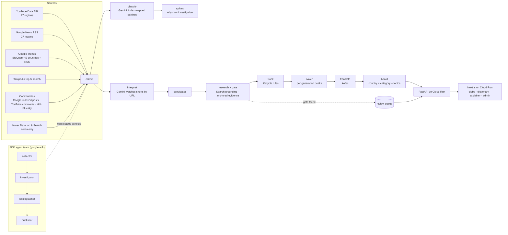

# Trend Interpreter — a verified, living dictionary of slang and memes across generations and countries

Entry for the **Google Cloud AI Builder Cup 2026 (JAPAC)** · theme: Media, Content & Digital Experiences.
Korean working notes live in `docs/`; this file is the English overview for judges. (Prototype — sample data is labelled as such in the UI.)

## The problem

A message full of slang from another generation or country is unreadable — and looking it up is unreliable: meme wikis lag, search results contradict each other, and LLMs confidently invent meanings. Brands, newsrooms and localization teams make expensive mistakes with expressions they misread.

## What it does

1. **Explain a message.** Paste any text; every slang term, abbreviation or meme is matched against the dictionary and explained in the reader's language, tuned to the reader's generation and country. A model rewrites the message in plain language — never by word substitution.
2. **A living, verified dictionary.** Agents collect signals from 27 countries (YouTube, Google News, Google Trends via BigQuery and RSS, Wikipedia, communities, Naver for Korea), watch shorts with Gemini, research candidate terms, and admit a meaning only when a deterministic **verification gate** passes: the term must appear verbatim in ≥2 independent sources including a first-party signal, the expansion must exist in the evidence text, and it must not contradict the current meaning. Meanings are versioned; nothing is deleted.
3. **Why is this trending — here, now?** A 3D globe shows what each country is searching for and how the same trend mutates across borders (Squid Game in Korea vs. MrBeast's real-life version in the US vs. "Round 6" in Brazil). Sudden surges trigger a multi-source investigation (news, Wikipedia, YouTube, communities) that produces an anchored "why now" explanation and knowledge-graph edges.
4. **Autonomous by default, human by exception.** ~Everything that passes the gate publishes without a human. Only gate failures (missing evidence, conflicting meanings) go to a review queue with an audit trail.

## Architecture



**Principle: data decides, the model narrates.** Lifecycle stage, verification status and re-check intervals come from rule code (`lifecycle.py`, `verification.py`). Gemini extracts, researches and writes; it never sets a status. Local Gemma (Ollama) is used for classification/translation experiments and is optional in deployment.

## Google Cloud / Google AI used

| | |
|---|---|
| Gemini 3.8 Flash (AI Studio API) | video understanding of YouTube Shorts by URL, Search-grounded research, batch classification, why-now explanations, translations, plain-language rewrite |
| Gemma 4 (Ollama, local) | classification/translation/rewrite experiments; never defines meanings |
| Agent Development Kit (google-adk 2.9) | four-agent sequential team orchestrating the deterministic stages as tools, with a daily model budget guard |
| BigQuery | `bigquery-public-data.google_trends` international top/rising terms (42 countries) |
| Spanner Graph (emulator locally, free-trial instance planned) | dictionary knowledge graph: Term → Meaning versions → Evidence, variants, usage by generation × country |
| Cloud Run | API and web containers (`Dockerfile.api`, `web/Dockerfile`), pipeline as a Cloud Run Job on a Scheduler |

## Evaluation

`uv run scripts/eval.py` regenerates `docs/EVAL.md`: rule tests, a 47-case message-matching battery, an 8-case hallucination/insufficient-evidence gate fixture set (8/8 blocked or passed as expected), spike-explanation anchoring rate, dictionary verification counts and pipeline health.

## Run locally

```bash
cp .env.example .env               # keys: see docs/KEYS.md
uv run scripts/run_pipeline.py     # one full pass; --loop for continuous
uv run scripts/serve_api.py        # http://localhost:8080/docs
cd web && pnpm install && NEXT_PUBLIC_DATA_MODE=api pnpm dev
uv run scripts/run_agents.py       # ADK agent team (or --dry to print the tree)
uv run pytest -q && uv run scripts/eval.py
```

## Honest limitations

- Per-generation data exists only for Korea (Naver DataLab). Elsewhere, generation is inferred by the model from content and platform context and shown only when confident.
- Google Trends daily queries are dominated by sports and people; dictionary growth relies on shorts, news and communities.
- X/TikTok are excluded (terms of service and cost). Reddit requires API approval (pending). Naver Search results are display-only per Naver's terms.
